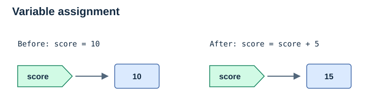
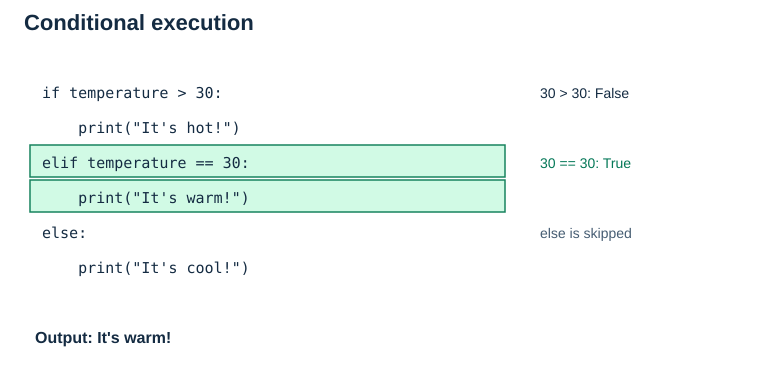
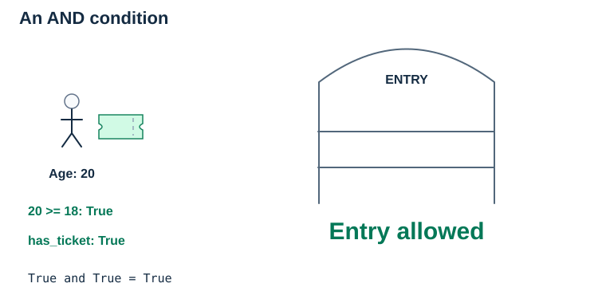
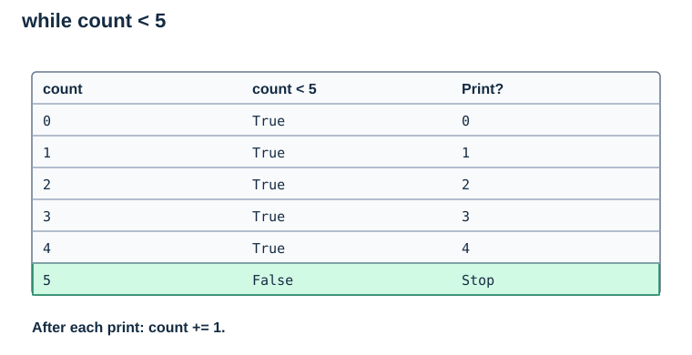
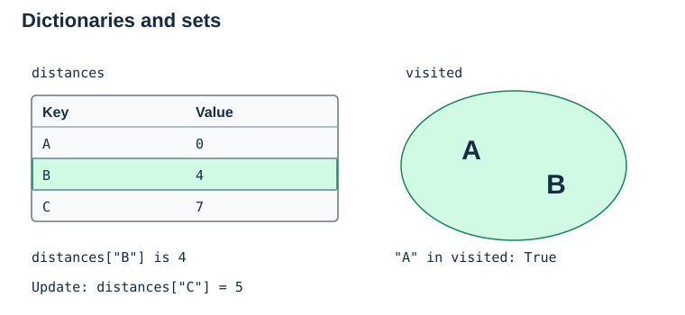
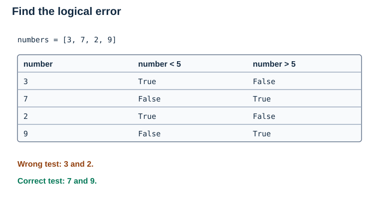

# Chapter 0: Introduction to Python Programming

> **Purpose:** Learn enough Python syntax to read and understand the code examples in the algorithms modules. This module assumes no prior Python experience.

## Learning Objectives
## Contents

- [Learning Objectives](#learning-objectives)
- [1. Before You Start: Running the Examples](#1-before-you-start-running-the-examples)
- [2. Variables and Basic Data Types](#2-variables-and-basic-data-types)
- [3. Statements and Conditional Statements](#3-statements-and-conditional-statements)
- [4. Relational (Comparison) Operators](#4-relational-comparison-operators)
- [5. Logical Operators](#5-logical-operators)
- [6. Loops](#6-loops)
- [7. Functions and Return Values](#7-functions-and-return-values)
- [8. Lists, Dictionaries, and Sets](#8-lists-dictionaries-and-sets)
- [9. Imports and Standard Libraries](#9-imports-and-standard-libraries)
- [10. Basic Debugging and Error Handling](#10-basic-debugging-and-error-handling)
- [11. Bringing It Together: Linear Search](#11-bringing-it-together-linear-search)
- [12. Quick Self-Check](#12-quick-self-check)
- [Suggested Further Reading](#suggested-further-reading)


By the end of this module, you should be able to:
- Create and update variables using basic Python data types.
- Read simple statements, conditions, and indented code blocks.
- Compare values using relational (comparison) operators and combine conditions with logical operators.
- Use `for` and `while` loops to repeat tasks.
- Define and call functions, and understand `return`.
- Work with lists, dictionaries, and sets.
- Recognize basic imports and diagnose common programming errors.

---

## 1. Before You Start: Running the Examples

Use Python 3. These algorithm lessons use only Python's standard library; no extra packages are required. The optional C example in the recursion lesson needs a separate C compiler.

1. Open a Python editor, such as IDLE, or a browser-based Python 3 editor.
2. Copy a complete `python` code block into a new file, preserving its indentation. Do not copy the Markdown fences (` ``` `).
3. Run the file using the editor's Run command. With a local installation, you can also save it as `example.py` and run `python example.py` in a terminal from that folder. On Windows, `py example.py` may be available instead.
4. Compare the displayed result with the supplied output or comments. Run separate examples separately unless the text says otherwise.

Blocks labelled `text` contain output, diagrams, or pseudocode; they are not Python programs.

---

## 2. Variables and Basic Data Types

A **variable** is a name that refers to a value. You can think of it as a label attached to information your program uses.

```python
age = 18
name = "Alex"
height = 1.75
is_student = True

print(name)  # Alex
print(age)   # 18
```

In Python, you do not need to declare the variable's type beforehand. Python determines it based on the assigned value.

| Data type | Meaning | Example |
|---|---|---|
| `int` | Whole number | `10`, `-3` |
| `float` | Decimal number | `3.14` |
| `str` | Text (string) | `"Hello"` |
| `bool` | Boolean value | `True`, `False` |
| `list` | Ordered, changeable collection | `[4, 2, 7]` |

A variable can be updated:

```python
score = 10
score = score + 5
print(score)  # 15
```

**Note:** The `=` symbol means *assignment* (store a value), not mathematical equality.



### 2.1 Basic arithmetic

| Operator | Meaning | Example | Result |
|---|---|---|---|
| `+` | Add | `7 + 2` | `9` |
| `-` | Subtract | `7 - 2` | `5` |
| `*` | Multiply | `7 * 2` | `14` |
| `/` | Divide | `7 / 2` | `3.5` |
| `//` | Floor division | `7 // 2` | `3` |
| `%` | Remainder | `7 % 2` | `1` |
| `**` | Exponent | `2 ** 3` | `8` |

The remainder operator `%` is useful for checking if a number is even:

```python
number = 8
print(number % 2 == 0)  # True
```

---

## 3. Statements and Conditional Statements

A **statement** tells Python to perform an action. Assignment, printing, and making decisions are all examples.

```python
x = 10          # Assignment statement
print(x)        # Print statement
```

A **conditional statement** makes a decision based on whether a condition is true or false:

```python
temperature = 30

if temperature > 30:
    print("It's hot!")
elif temperature == 30:
    print("It's warm!")
else:
    print("It's cool!")
```

Python tests the branches from top to bottom, executes the first matching branch, and skips the others. `else` runs only if no previous condition matches.

**Indentation matters:** The four spaces before `print()` tell Python that the statement belongs to that branch. Unlike some languages, Python uses indentation to group code.



---

## 4. Relational (Comparison) Operators

**Relational operators** compare values and produce `True` or `False`.

| Operator | Meaning | Example | Result |
|---|---|---|---|
| `==` | Equal to | `5 == 5` | `True` |
| `!=` | Not equal to | `5 != 3` | `True` |
| `>` | Greater than | `8 > 4` | `True` |
| `<` | Less than | `3 < 7` | `True` |
| `>=` | Greater than or equal to | `5 >= 5` | `True` |
| `<=` | Less than or equal to | `4 <= 6` | `True` |

Remember:
- `x = 5` **assigns** the value `5` to `x`.
- `x == 5` **checks** whether `x` equals `5`.

---

## 5. Logical Operators

Logical operators allow you to combine or reverse conditions.

| Operator | Meaning | Example | Result |
|---|---|---|---|
| `and` | Both conditions must be true | `True and False` | `False` |
| `or` | At least one condition must be true | `True or False` | `True` |
| `not` | Reverses a Boolean value | `not True` | `False` |

```python
age = 20
has_ticket = True

if age >= 18 and has_ticket:
    print("Entry allowed")
else:
    print("Entry denied")
```

In this example, the program permits entry only if **both** conditions are true.



---

## 6. Loops

**Loops** repeat instructions so you do not need to write the same code multiple times.

### 6.1 `for` loops

A `for` loop visits values in an iterable (such as a range or list), one at a time.

```python
for i in range(5):
    print(i)
```

Output:

```text
0
1
2
3
4
```

`range(5)` produces the integers from `0` through `4` (the end is excluded).



[Static version for print](../../../Assets/Algorithms/Static/python-for-range.svg)

You can also loop directly over a list:

```python
numbers = [8, 3, 5]

for number in numbers:
    print(number)
```

This is a common pattern in **linear search** and **sorting**.

### 6.2 `while` loops

A `while` loop keeps repeating **as long as its condition remains true**.

```python
count = 0

while count < 5:
    print(count)
    count += 1
```

`count += 1` is shorthand for `count = count + 1`. Without a change that eventually makes the condition false, a loop may run indefinitely.



### 6.3 `break` and `continue`

- `break` exits the nearest loop immediately.
- `continue` skips the rest of the current iteration and moves to the next one.

```python
for number in [2, 4, 7, 8]:
    if number == 7:
        break
    print(number)
# Prints 2 and 4
```

**Algorithm connection:** Binary search commonly uses a `while` loop to repeatedly narrow its search interval.

---

## 7. Functions and Return Values

A **function** is a reusable block of code. You define it using `def`, pass information in through **parameters**, and optionally send a result back using `return`.

```python
def add(a, b):
    return a + b

result = add(3, 5)
print(result)  # 8
```

Here, `a` and `b` are parameters; `3` and `5` are arguments. `return` sends `8` back to the place where the function was called. It is different from `print()`, which only displays something.



[Static version for print](../../../Assets/Algorithms/Static/python-function-return.svg)

Functions are especially important for understanding **recursion**: a recursive function calls itself on a smaller version of the problem.

```python
def countdown(n):
    if n <= 0:       # Base case: stop at zero or below
        return
    print(n)
    countdown(n - 1) # Recursive call

countdown(3)
# Prints 3, 2, 1
```

Here, `n` is an integer. Each recursive call reduces it toward the stopping condition. Python limits recursion depth, so use a loop for a long countdown.

---

## 8. Lists, Dictionaries, and Sets

These collections are useful throughout algorithms.

### 8.1 Lists

A **list** stores an ordered sequence of values. Its elements are indexed starting at `0`.

```python
numbers = [8, 3, 5, 1]

print(numbers[0])  # 8
numbers[1] = 10
numbers.append(7)
print(numbers)     # [8, 10, 5, 1, 7]
print(len(numbers)) # 5
```

Lists are commonly used for **sorting**, **searching**, and storing dynamic programming results.

![The value at index 1 becomes 10, then 7 moves into new index 4; the list becomes [8, 10, 5, 1, 7].](../../../Assets/Algorithms/Animated/python-list-update.svg)

[Static version for print](../../../Assets/Algorithms/Static/python-list-update.svg)

### 8.2 Dictionaries

A **dictionary** stores **key–value pairs**.

```python
distances = {"A": 0, "B": 4, "C": 7}

print(distances["B"])  # 4
distances["C"] = 5
```

Dictionaries are often used to store distances or parent nodes in **graph algorithms**.

### 8.3 Sets

A **set** stores unique values and supports fast membership checks on average.

```python
visited = set()
visited.add("A")
visited.add("B")

print("A" in visited)  # True
```

A `visited` set is commonly used in **BFS** and **DFS** to avoid repeatedly exploring the same node.



---

## 9. Imports and Standard Libraries

An **import** makes code from another module available for you to use. Python's standard library offers many helpful tools.

```python
from collections import deque

queue = deque(["A"])
queue.append("B")
print(queue.popleft())  # A
```

`deque` is useful for **BFS**, where a first-in, first-out queue is needed.

```python
import heapq

costs = [5, 2, 8]
heapq.heapify(costs)
print(heapq.heappop(costs))  # 2
```

`heapq` is often used to implement a **priority queue** in Dijkstra's algorithm and A*.

---

## 10. Basic Debugging and Error Handling

**Debugging** means identifying and fixing problems in a program.

| Error type | Description | Example |
|---|---|---|
| Syntax error | Python cannot understand the way code is written | Missing `:` after `if` |
| Runtime error | An error occurs during execution | `10 / 0` |
| Logical error | The program runs but produces the wrong result | Using `<` instead of `>` |

### 10.1 Example: Find the logical error

```python
numbers = [3, 7, 2, 9]

for number in numbers:
    if number < 5:
        print("Greater than 5:", number)
```

The label says "Greater than 5," but the condition selects numbers **less than 5**. The fix is:

```python
numbers = [3, 7, 2, 9]

for number in numbers:
    if number > 5:
        print("Greater than 5:", number)
```

Output:

```text
Greater than 5: 7
Greater than 5: 9
```



### 10.2 Practical debugging habits

1. **Read the error message:** It often identifies the line and the type of error.
2. **Print intermediate values:** Check what variables hold at important stages.
3. **Test simple and edge cases:** Try empty lists, one-element lists, and repeated values where appropriate.
4. **Use breakpoints:** An editor's debugger can pause execution and let you inspect values step by step.
5. **Check your logic:** Code that runs without errors may still produce incorrect results.

---

## 11. Bringing It Together: Linear Search

The following program combines variables, lists, loops, comparisons, conditionals, functions, and return values.

```python
def linear_search(numbers, target):
    for index in range(len(numbers)):
        if numbers[index] == target:
            return index
    return -1

values = [8, 3, 5, 1]
print(linear_search(values, 5))   # 2
print(linear_search(values, 10))  # -1
```

**Walkthrough:**
1. The function receives a list and a target.
2. The loop visits each index in order.
3. `==` checks whether the current element matches the target.
4. If a match is found, `return index` ends the function immediately.
5. If every element has been checked without a match, the function returns `-1`.

This is the foundation for understanding more advanced searching algorithms.



[Static version for print](../../../Assets/Algorithms/Static/python-linear-search.svg)

## 12. Quick Self-Check

1. What is the difference between `=` and `==`?
2. Why does `range(5)` end at `4`, not `5`?
3. When would you use a `while` loop instead of a `for` loop?
4. What is the difference between `return` and `print()`?
5. Why might a graph-search algorithm use a `visited` set?
6. If a program runs but prints the wrong numbers, what category of error is that?

### 12.1 Answers

1. `=` assigns a value; `==` compares two values.
2. The stop value in `range` is excluded, so `range(5)` gives `0, 1, 2, 3, 4`.
3. Use `while` when repetition depends on a condition rather than visiting each item in a collection.
4. `return` sends a value to the caller and ends that function call; `print()` displays a value.
5. It records discovered nodes so cycles and multiple routes do not cause repeated exploration.
6. A logical error.

## Suggested Further Reading

- [Python Official Tutorial](https://docs.python.org/3/tutorial/)
- [Python Tutorial: Control Flow Tools](https://docs.python.org/3/tutorial/controlflow.html)
- [Python Tutorial: Data Structures](https://docs.python.org/3/tutorial/datastructures.html)
- [Python Documentation: `collections.deque`](https://docs.python.org/3/library/collections.html#collections.deque)
- [Python Documentation: `heapq`](https://docs.python.org/3/library/heapq.html)

**Next module:** [Introduction to Algorithms](01%20introduction%20to%20algorithms.md) — now that you can read the Python code, focus on *what each algorithm is doing* and *why it works*.
