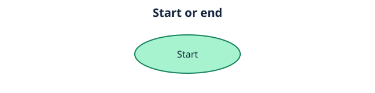
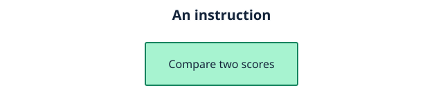
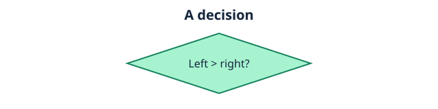
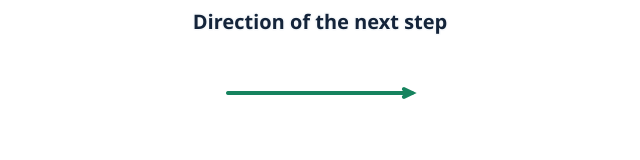
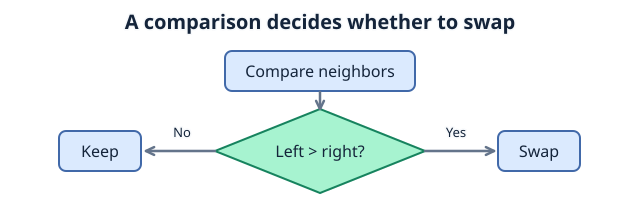

# Chapter 1: Introduction to Algorithms
## Contents

- [1. What Are Algorithms?](#1-what-are-algorithms)
- [2. Examples](#2-examples)
- [3. Implementation](#3-implementation)
- [4. Importance of Algorithms in Programming](#4-importance-of-algorithms-in-programming)
- [5. Characteristics of an Algorithm](#5-characteristics-of-an-algorithm)
- [6. Describing an Algorithm](#6-describing-an-algorithm)
- [7. Visualization](#7-visualization)
- [8. Representing Algorithms](#8-representing-algorithms)
- [9. Check Your Understanding](#9-check-your-understanding)
- [References](#references)
## 1. What Are Algorithms?
### 1.1 Definition of an Algorithm
An **algorithm** is a finite sequence of precise, well-defined instructions designed to solve a problem or complete a task.

An algorithm takes zero or more inputs, processes them through its instructions, and produces a result.

An **algorithm** describes a method. A **program** implements methods in a programming language and can contain several algorithms.

---

## 2. Examples
Consider sorting students' grades in ascending order, from smallest to largest.

Given the scores **[72, 85, 40, 29, 100, 91]**, **bubble sort** repeatedly compares the *values* at neighboring positions `j` and `j + 1`. If the left value is larger, it swaps them. Each complete pass places the largest remaining value at the end of the unsorted portion. Several passes may be needed to sort the whole list.

## 3. Implementation
### 3.1 Python example
```python
grades = [72,85,40,29,100,91]
length = len(grades)
for i in range(length):
    for j in range(0, length-1-i):
        if grades[j] > grades[j+1]:
            grades[j], grades[j+1] = grades[j+1], grades[j]
print("Sorted array: \n" + str(grades))
```
Expected output:

```text
Sorted array:
[29, 40, 72, 85, 91, 100]
```

In this code, `>` sorts in ascending order. Changing the comparison to `<` sorts in descending order. These are **relational (comparison) operators**; changing the operator changes the result.
This is an example of an algorithm, it uses a sequence of precise commands to complete a task (sorting numbers).


## 4. Importance of Algorithms in Programming
Algorithms provide a structured approach to solving problems.

They help:

* Solve problems systematically by breaking complex problems into smaller, manageable steps.
* Provide methods for solving problems.
* Reuse solutions: Once implemented, you can apply established problem solving methods to different problems.
---
Different algorithms can solve the same problem using different approaches.

For example, a navigation program can evaluate routes between two locations. **BFS** explores by number of edges, **Dijkstra's algorithm** prioritizes the lowest accumulated cost, and **A*** also uses an estimate of the remaining cost. They have different requirements and guarantees, explained in the later graph lessons.

## 5. Characteristics of an Algorithm
**Input:** Accepts >= 0 values or pieces of information

**Output:** Produces a definite result.

**Definiteness:** Instructions are clear, precise, and unambiguous.

**Finiteness:** The algorithm terminates after a finite number of steps for each valid input.

**Effectiveness:** Each instruction is concrete enough to carry out.

Simply telling a computer to "sort these numbers" or "find the best route" is not a complete algorithm, because it does not explain how the numbers should be sorted, or how routes should be evaluated.

## 6. Describing an Algorithm
Consider the Python bubble sort example above.

We can sort them in ascending order by describing them in detailed steps:

1. Start a pass at the beginning of the unsorted portion.

2. Compare each adjacent pair from left to right.

3. If the left value is greater than the right value, swap them.

4. After the pass, exclude its last position: that value is now in its final place.

5. Repeat passes until fewer than two unsorted items remain, then return the sorted list. A single pass is not enough in general.

## 7. Visualization
Consider the following list:
**[72,85,91,68]**

### 7.1 The bubble sort algorithm processes the values as follows:


```text
Initial list:
[72] [85] [91] [68]

Pass 1:
[72] [85] [91] [68]
  ^    ^
(72 > 85) is False. No swap.

[72] [85] [91] [68]
       ^    ^
(85 > 91) is False. No swap.

[72] [85] [91] [68]
           ^    ^
(91 > 68) is True. Swap!
Result of Pass 1: [72] [85] [68] [91] (91 bubbles to the end)

Pass 2:
[72] [85] [68] [91]
  ^    ^
(72 > 85) is False. No swap.

[72] [85] [68] [91]
       ^    ^
(85 > 68) is True. Swap!
Result of Pass 2: [72] [68] [85] [91] (85 bubbles to its place)

Pass 3:
[72] [68] [85] [91]
  ^    ^
(72 > 68) is True. Swap!
Result of Pass 3: [68] [72] [85] [91]

Final output:
[68] [72] [85] [91]
```


### 7.2 At its core, this is how an algorithm gradually processes input data until it produces the expected result.

## 8. Representing Algorithms
Algorithms can be represented in several ways, including natural language,pseudocode, and flowcharts.

### 8.1 Pseudocode
Informal,programming-like way of describing an algorithm without following the exact syntax of a particular programming language.

pseudocode does not have a universal syntax. Recall the [sorting example](#implementation), we can represent sorting numbers in a nonempty list in pseudocode:
The bounds below are inclusive. `length - 2 - i` keeps `j + 1` inside the unsorted portion. If an upper bound is below zero, that loop has no iterations.

```text
Set grades to [72, 85, 40, 29, 100, 91]
Set length to the number of grades
for i from 0 to length - 2
    for j from 0 to length - 2 - i
        if grades[j] > grades[j+1] then
            swap grades[j] with grades[j+1]
        END if
    END FOR
END FOR
print "Sorted array: " and grades
```

### 8.2 Flowcharts
A flowchart represents an algorithm using connected shapes and arrows.

### 8.3 Flowchart symbols:
* oval: start/end

  

* Rectangle: Operation/Instruction

  

* Diamond: Condition/Decision

  

* Arrow: Direction the algorithm proceeds.

  



This diagram shows one comparison, not the complete sorting loop.

## 9. Check Your Understanding

After one left-to-right bubble sort pass on `[3, 2, 1]`, is the list sorted?

**Answer:** No. It becomes `[2, 1, 3]`. Another pass is needed to order `2` and `1`.


## References

- Python Software Foundation, Python Tutorial, “More Control Flow Tools”: loops, comparisons, and functions.
- MIT OpenCourseWare, 6.006 Introduction to Algorithms, Fall 2011, Lecture 1: algorithmic thinking.
