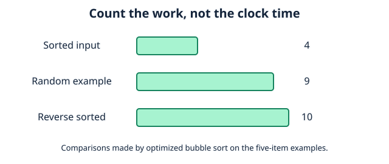

# Chapter 2: Basic Sorting Algorithms
## Contents

- [1. Improving Bubble Sort](#1-improving-bubble-sort)
- [2. Efficiency](#2-efficiency)
- [3. Same Problem, Different Algorithms](#3-same-problem-different-algorithms)
- [4. Selection Sort](#4-selection-sort)
- [5. Insertion Sort](#5-insertion-sort)
- [6. Comparing the Algorithms](#6-comparing-the-algorithms)
- [7. Check Your Understanding](#7-check-your-understanding)
- [References](#references)
## 1. Improving Bubble Sort
Suppose our grades were already sorted:
```
[29, 40, 72, 85, 91, 100]
```
The original approach **still** performs every pass. We can improve it by detecting when no more swaps are needed.

Record whether any swaps happen during a pass. If a complete pass makes no swaps, the list is already sorted and the algorithm can stop.
```python
grades = [72, 85, 40, 29, 100, 91]
length = len(grades)

for i in range(length - 1):
    swapped = False

    for j in range(length - 1 - i):
        if grades[j] > grades[j + 1]:
            grades[j], grades[j + 1] = grades[j + 1], grades[j]
            swapped = True

    if not swapped:
        break

print(grades)
```
Expected output: `[29, 40, 72, 85, 91, 100]`.

Early stopping reduces comparisons when a pass makes no swaps. It improves the best case to `O(n)`, but the worst case is still `O(n²)`.



## 2. Efficiency
when comparing efficiency, ask yourself:

* how many items are checked?
* How many comparisons/movements are made?
* How much information must be stored while it is working?

Sorting our list of grades in ascending order with bubble sort gives different amounts of work for how "out of order" the initial list is. 

These counts use the optimized code above. A comparison means one test of `grades[j] > grades[j + 1]`; loop-condition checks are excluded.

| Initial Data Condition | Comparisons Made | Swaps Made |
| --- | ---: | ---: |
| `[55, 65, 75, 85, 95]` Already sorted | 4 | 0 |
| `[75, 55, 95, 65, 85]` Example unsorted order | 9 | 4 |
| `[95, 85, 75, 65, 55]` Reverse sorted | 10 | 10 |

The unsorted example makes `4 + 3 + 2 = 9` comparisons. Its third pass makes no swaps, so the final possible pass is skipped. One example is not an average-case measurement.

The easiest situation is our **best case.**

The hardest situation requiring the most work is our **worst case**

Our **average case** depends on assumptions about which inputs are likely.



## 3. Same Problem, Different Algorithms
Recall the same problem: sort this list of grades in ascending order:
```
[72,85,91,68] 
```
in [Introduction to Algorithms](01%20introduction%20to%20algorithms.md) we primarily used Bubble sorting which compares adjacent numbers, and swaps them if they are in the wrong order, now we can introduce another sorting algorithm.
## 4. Selection Sort
1. Treat the first unsorted index as the position of the minimum.
2. Scan **all remaining unsorted items**. Whenever a smaller value is found, remember its index.
3. Swap that minimum with the first unsorted item, unless it is already there.
4. Advance the start of the unsorted portion and repeat until fewer than two items remain.



```python
def selection_sort(values):
    for start in range(len(values) - 1):
        minimum = start
        for index in range(start + 1, len(values)):
            if values[index] < values[minimum]:
                minimum = index
        if minimum != start:
            values[start], values[minimum] = values[minimum], values[start]
    return values

print(selection_sort([72, 85, 91, 68]))
```

Expected output: `[68, 72, 85, 91]`.

## 5. Insertion Sort
Return to the list `[72, 85, 91, 68]`.

1. Skip the first index [0], a single  element is always sorted.
2. Store the next element's value separately as the **key**, so it is not lost during shifts.
3. Compare the key with the element to its left. If the key is smaller, shift that element right.
4. Keep shifting while the element to the left is **greater than** the key. Stop at an element less than or equal to the key, or at the start of the list.
5. **Insert** the key into the empty position.
6. Move to the next index and repeat until every item has been inserted into the sorted portion.
The animation uses a separate example, `[7, 4, 9, 2, 5]`.



The portion to the left is sorted; the remaining portion is not yet processed.

```python
def insertion_sort(values):
    for index in range(1, len(values)):
        key = values[index]
        left = index - 1
        while left >= 0 and values[left] > key:
            values[left + 1] = values[left]
            left -= 1
        values[left + 1] = key
    return values

print(insertion_sort([7, 4, 9, 2, 5]))
```

Expected output: `[2, 4, 5, 7, 9]`.

## 6. Comparing the Algorithms

All three implementations modify the input list in place and use `O(1)` auxiliary space. Optimized bubble sort and insertion sort take `O(n)` time on sorted input and `O(n²)` in the worst case. Selection sort always performs `n(n - 1) / 2` value comparisons, so its best and worst cases are `O(n²)`.

Bubble sort and insertion sort preserve the original order of equal-valued items when they swap or shift only on `>`. This property is called **stability**. The selection sort shown here is not stable in general because its swaps can move equal-valued items past one another.

## 7. Check Your Understanding

After the first selection sort pass on `[3, 1, 2]`, what is the list? What does insertion sort produce after inserting its second item?

**Answer:** Both produce `[1, 3, 2]`, but they reach it differently: selection sort finds the minimum of the entire unsorted portion, while insertion sort inserts `1` into the sorted portion containing `3`.


## References

- MIT OpenCourseWare, 6.006 Introduction to Algorithms, Fall 2011, Lecture 3: insertion sort and its analysis.
- OpenDSA, “Bubble Sort”, “Selection Sort”, and “Insertion Sort”: comparison counts, stability, and operation costs.
