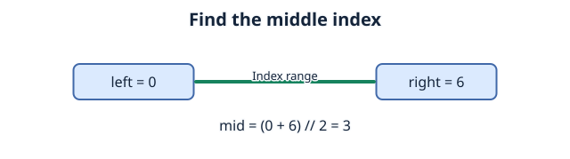
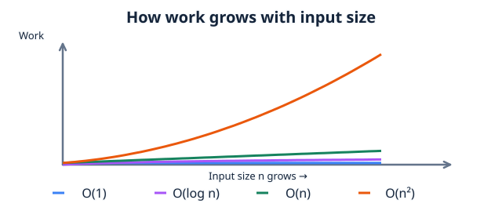

# Chapter 3: Binary Search, Linear Search, and Big O Notation
## Contents

- [1. Linear Search](#1-linear-search)
- [2. Binary Search](#2-binary-search)
- [3. Big O Notation](#3-big-o-notation)
- [4. Check Your Understanding](#4-check-your-understanding)
- [References](#references)
## 1. Linear Search
if sorting arranges items, searching finds a particular item.

Linear search, at its core is essentially a way to find a target by examining elements one by one.

### 1.1 given an array of integers: [72,85,91,68] you're assigned to find 68.
finding 68 itself requires **4** checks, finding 91 requires **3**, finding 85 requires **2** , finding 72 requires **1**.


**Linear search**:
1. start at first index (0)
2. Compare the current element with the target.
3. If the value matches, stop searching.
4. If the value does not match, move to the next index.
5. Stop at the first match or after checking every item. If there is no match, report that the target is absent.



#### 1.1.1 Implementation (python):
```python
def linear_search(values, target):
    for index in range(len(values)):
        if values[index] == target:
            return index
    return -1

array_one = [72, 85, 91, 68]
index = linear_search(array_one, 68)
if index == -1:
    print("Target not found")
else:
    print(f"found 68 at index {index}")
```
#### 1.1.2 output: found 68 at index 3
**Important distinction:** searching finds a target's location; sorting rearranges items into an order.

Something else to note is the fact that linear search works whether the array is sorted or unsorted.

## 2. Binary Search
Now ask yourself:

1. what happens as the dataset grows? what if our array has a million or more elements?

2. What happens if our target is at the end of said array?

A linear search may need to inspect all those items. If the data is already sorted and supports direct index access, binary search can reduce the number of inspected items substantially. Sorting first also costs work, so linear search may still be sensible for a single query on unsorted data.

If Linear search checks one by one, binary search repeatedly eliminates half of remaining possibilities with one requirement:
**The values must be sorted using the same comparison order.** The example below assumes ascending order. Its `O(log n)` time bound also assumes constant-time index access, as with an array or Python list.
### 2.1 given an array of integers: [1,3,5,7,9, 11, 13] we want to find the target: 11

1. Find, and examine the middle of the array.
2. Compare the value of the element with our target
3. If the middle value matches, return its index.
4. If the middle value is greater than the target, keep only the items to its left. If it is smaller, keep only the items to its right.
5. Repeat until target is found or there are no elements left to search.



#### 2.1.1 To find, and examine the middle element, think of the midpoint formula:
```
Minimum + Maximum
__________________
        2
```

In our example, `(0 + 6) // 2 = 3`, so the middle element is at index `3`. Parentheses add the bounds before division, and `//` rounds down to an integer index.

We are finding the midpoint between index bounds:

```
mid = (left + right) // 2
```

`left` is the first index in the current search range, `right` is the last index (included), and `mid` is the middle index rounded down.



### 2.2 Implementation (Python)
```python
def binary_search(arr, target):
    low = 0
    high = len(arr) - 1

    while low <= high:
        mid = (low + high) // 2
        if arr[mid] == target:
            return mid

        elif arr[mid] < target:
            low = mid + 1

        else:
            high = mid - 1
    return -1

numbers = [10, 23, 35, 42, 57, 68, 71, 85, 92]
target_value = 68

index = binary_search(numbers, target_value)
print(f"Target {target_value} found at index: {index}")
```
Output: Target 68 found at index: 5

An empty list or an absent target returns `-1`. If values repeat, this binary search returns a matching index, which may not be the first match. Do not use a returned `-1` to index the list: in Python, index `-1` refers to its last item.

## 3. Big O Notation

Here, `n` is the number of input items. For operation counts and growth examples, see [Time Complexity Analysis](05%20time%20complexity%20analysis.md).

**Big O** describes an asymptotic upper bound on growth, rather than an exact running time. State the case being analyzed: for example, linear search has `O(1)` best-case time and `O(n)` worst-case time. The table gives common bounds; it does not mean every run takes that much work.

---

| Label | Reading | Example|
| --- | --- | --- |
| `O(1)` | Constant | accessing an element of an array |
| `O(log n)` | Logarithmic | Binary search|
| `O(n)` | Linear | Linear search|
| `O(n²)` | Quadratic | Bubble sort |
----




## 4. Check Your Understanding

What do both functions return for an empty list? How many middle items does binary search inspect when finding `11` in `[1, 3, 5, 7, 9, 11, 13]`?

**Answer:** Both return `-1` for an empty list. The binary search inspects `7`, then `11`: two middle items.


## References

- Python Software Foundation, Python Tutorial, “More Control Flow Tools”: `range`, loops, and early returns.
- OpenDSA Data Structures and Algorithms Modules Collection, “Searching in an Array”: sequential search, binary search, and logarithmic search depth.
