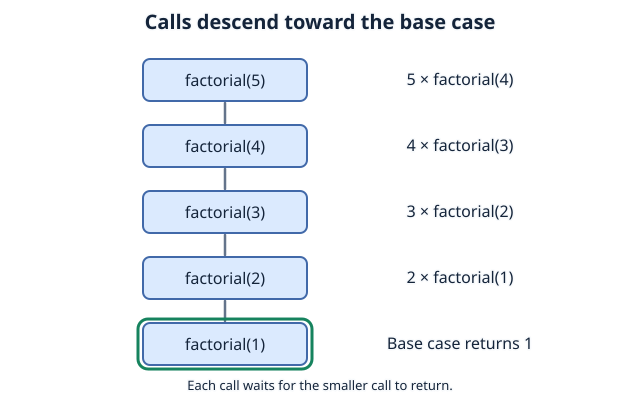
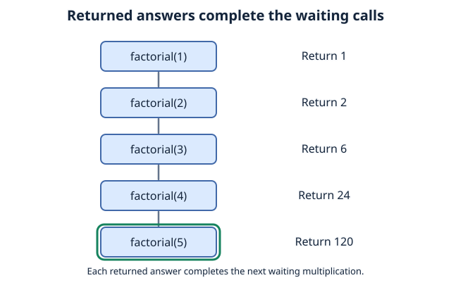

# Chapter 4: Recursion and Call Stack
## Contents

- [1. What Is Recursion?](#1-what-is-recursion)
- [2. Call Stack](#2-call-stack)
- [3. Cost and Limitations](#3-cost-and-limitations)
- [4. Check Your Understanding](#4-check-your-understanding)
- [References](#references)
## 1. What Is Recursion?
**Recursion** is a technique where a function calls itself directly or indirectly. The examples here solve a smaller version of the same problem until they reach a stopping condition.

The call that started the work waits while a smaller recursive call supplies an answer.

We will calculate **factorial**: for a non-negative integer `n`, `n!` is the product `1 × 2 × ... × n`, with `0! = 1`. For example, `5! = 120`.

The C version below is optional; the Python version is sufficient for this module. The C program accepts integer input from `0` through `20` so the result fits in a `long long`.

### 1.1 Iterative implementation (C)
```c
#include <stdio.h>
#include <stdlib.h>
#include <errno.h>
#include <ctype.h>
#include <string.h>
int main(void)
{
    char input[128];
    char *end;
    long long sum = 1;
    if (fgets(input, sizeof input, stdin) == NULL)
    {
        printf("Invalid integer\n");
        return 1;
    }
    if (strchr(input, '\n') == NULL && strlen(input) == sizeof input - 1)
    {
        printf("Input line is too long\n");
        return 1;
    }
    errno = 0;
    long num1 = strtol(input, &end, 10);
    if (end == input || errno == ERANGE)
    {
        printf("Invalid integer\n");
        return 1;
    }
    while (isspace((unsigned char)*end))
    {
        end++;
    }
    if (*end != '\0' || num1 < 0 || num1 > 20)
    {
        printf("Enter an integer from 0 through 20\n");
        return 1;
    }
    for (int i=1; i<=num1; i++)
    {
        sum = sum * i;
    }
    printf("%lld\n", sum);
    return 0;
}


```
### 1.2 Recursive implementation (Python)

```python
def factorial_recursive(n):
    if not isinstance(n, int):
        raise TypeError("n must be an integer")
    if n < 0:
        raise ValueError("Factorial is not defined for negative numbers")
    if n == 0 or n == 1:
        return 1
    return n * factorial_recursive(n - 1)

# Example usage:
print(factorial_recursive(5))  # Output: 120
```
Both implementations calculate `120` for input `5` and `1` for input `0`. Negative integers are rejected. The Python function also rejects non-integer inputs. Python integers can grow beyond the C type's range, but recursive calls are limited by Python's recursion depth and available memory.

In the optional C example, `fgets` reads a line, `strtol` converts it to an integer, and the checks reject invalid or out-of-range input before multiplication. Save it as `factorial.c`, compile with a C99-or-later compiler (for example, `gcc -std=c99 factorial.c -o factorial`), then run the executable and enter a value such as `5`.

Recursion has two main components:
1. Base Case:  The simplest possible version of the problem that can be answered immediately. This stops the function from calling itself forever.
2. Recursive Case: Break the problem into a smaller problem and make a recursive call, moving toward the base case.

Each recursive factorial call moves toward the base case by reducing `n` by one:


what happens after we reach the base case?


## 2. Call Stack
Recall the [recursion example](#what-is-recursion), and ask yourself again:

1. how does the program know where it left off?
2. how does the program know which function it should return to?

Call stack: a data structure that keeps track of active function calls during a program's execution. Whenever a function is called, the program adds a new entry, known as a stack frame, to the call stack.

Every time a function calls itself, the program pushes a new stack frame, onto the call stack using a Last-in, First-out (LIFO) order.

adding a function: push

removing a function: pop

since it goes in the order of last in, first out, the newest call must be evaluated and 'popped' first (LIFO).

implementation with our factorial calculator:


When factorial(1) returns 1, its stack frame is removed.

Then factorial(2) can finish, followed by factorial(3), and so on.


----

## 3. Cost and Limitations

For non-negative integer `n`, the recursive version uses `O(n)` calls and `O(n)` call-stack space; the loop uses `O(n)` multiplications and `O(1)` auxiliary space in the usual fixed-size-number model. Python's large-integer multiplications cost more as the result grows, so these operation counts are not exact bit-operation bounds. A loop avoids the recursion-depth limit.

A base case alone is insufficient: each recursive call must move toward it. Calling a function with the same argument repeatedly can still cause unbounded recursion.

## 4. Check Your Understanding

What does `factorial_recursive(0)` return? Why would replacing `n - 1` with `n` break the recursive case?

**Answer:** It returns `1`. Using `n` again would never reach the base case for `n > 1`, eventually causing `RecursionError`.


## References

- Python Software Foundation, Python Tutorial, “More Control Flow Tools”: defining and returning from functions.
- Python Software Foundation, `sys.getrecursionlimit` documentation: limits on interpreter-stack depth.
