# Chapter 6: Graph Searching: BFS, DFS & Routing and Coverage
## Contents

- [1. Graphs](#1-graphs)
- [2. Graph Traversal](#2-graph-traversal)
- [3. Graph Searching](#3-graph-searching)
- [4. Connection to Pathfinding](#4-connection-to-pathfinding)
- [5. Breadth-First Search (BFS)](#5-breadth-first-search-bfs)
- [6. Depth-First Search (DFS)](#6-depth-first-search-dfs)
- [7. DFS vs BFS](#7-dfs-vs-bfs)
- [8. Recovering a Shortest Path with BFS](#8-recovering-a-shortest-path-with-bfs)
- [9. Coverage and Complexity](#9-coverage-and-complexity)
- [10. Check Your Understanding](#10-check-your-understanding)
- [References](#references)
## 1. Graphs
Graphs are a foundation for pathfinding. First, recall how they represent connections.

Graphs, as explained in our **Data structure** modules is a data structure used to represent relationships.
* vertices(nodes) : locations/points/objects
* Edges: connections between those nodes/vertices.

The graph's properties determine which searches and routes are valid:

1. Directed graphs: **each edge has a direction. An edge from A to B does not imply an edge from B to A.**

   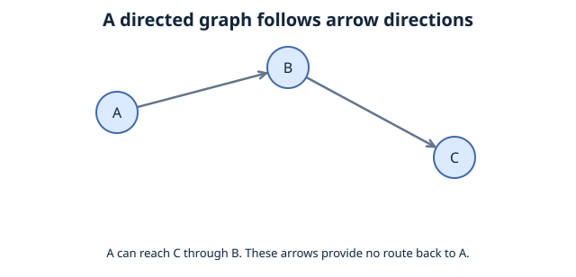

2. Undirected graphs: **each edge can be followed in either direction, representing a mutual connection.**

   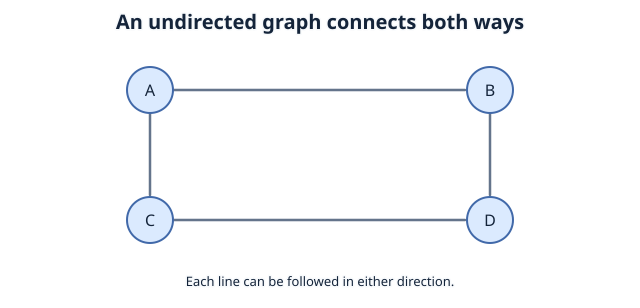

3. Weighted graphs: **edges have weight, typically representing cost, distance,time,etc**

   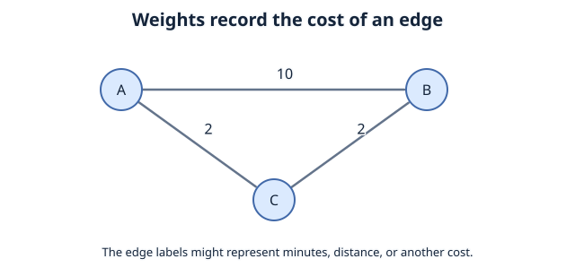

4. Unweighted graphs: **edges have no separate numerical costs; each edge counts as one step when measuring route length.**

   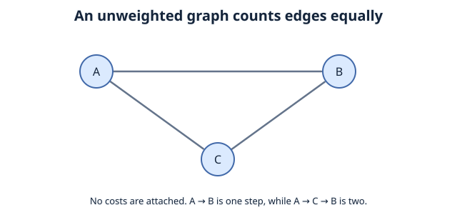

Direction and weighting are separate properties: a graph can be both directed and weighted. In the undirected example, vertices A–D could represent rooms and edges could represent connecting doors.

## 2. Graph Traversal
### 2.1 definition:
process of systematically visiting nodes in a graph.

Traversal visits nodes systematically; it need not modify their stored data. Starting from one node visits only nodes reachable from that start. A disconnected graph may need several starting points to cover every vertex.

later on in the module, you'll see an implementation of BFS, and DFS, they're the primary algorithms used graph traversal. 


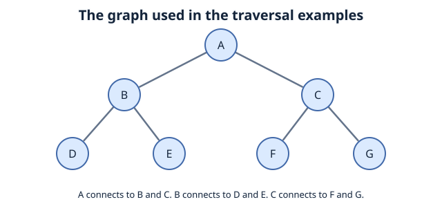

look at this specific graph as an example, and note:
**there can be multiple ways to traverse the same graph.**

we could:
1. explore all nodes at the current level, and then moves to the next level and repeat:

```
Possible traversal order:
A > B > C > D > E > F > G
A > C > B > G > F > E > D
A > B > C > E > D > G > F
```

This particular graph is tree-shaped. With A chosen as its root, B and C are A's children; D and E are B's children; F and G are C's children. D–G are descendants of A, not its direct children. A general graph has a **start vertex**, but no inherent root or parent-child hierarchy.

This specific traversal order is often used by **BFS**, one of our introductory pathfinding algorithms.

Recall [the call stack](04%20recursion%20and%20call%20stack.md#call-stack): if stacks operate on the principle **LIFO**, then **queue** operates on **FIFO**

**FIFO** = First in, First out. this is how **BFS** maintains this specific traversal order.

2. Explore one branch as deeply as possible before **backtracking** to try another unvisited branch. This is DFS, rather than level-by-level exploration.

```
Possible traversal order:
A > B > D > E > C > F > G
A > C > G > F > B > E > D
A > B > E > D > C > F > G
```
**LIFO** = Last in, First out. This is how DFS Maintains this specific traversal order.
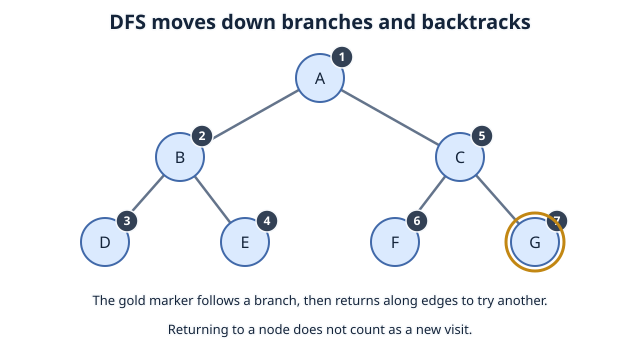

## 3. Graph Searching
[Graph Traversal](#graph-traversal) described visit orders without a target. A search adds a goal, such as finding vertex E.

Traversal can be used for searching by adding a target test. A target search can stop at a match; if no reachable vertex matches, it must report failure after exhausting the reachable vertices.

If Graph traversal's goal is to visit and explore every node systematically, then Graph searching involves finding a specific target node or value, with a stop condition implemented as well to stop once the target is found.

Recall the possible ways to traverse through a graph and what pathfinding algorithm was associated with the order...those algorithms use graph traversal strategies, but graph searching adds a goal, target, and check.


## 4. Connection to Pathfinding

The best way to sum up pathfinding is by asking yourself how can you get from a starting point (node) A,  to an end point (target),B through all possible valid **routes**.

you can find a path, but which route is takes the fewest steps, whats the shortest path? Its important to note that not every graph searching algorithm guarantees the shortest path.

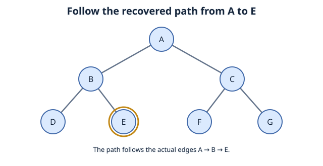

## 5. Breadth-First Search (BFS)
BFS - Breadth-First Search is our first graph traversal algorithm.

### 5.1 How BFS Works
* starts off from its starting node
* explores level by level
* gradually moves farther away
* can find the shortest path in an unweighted graph


uses queue (FIFO) to remember which nodes to explore next.




### 5.2 Implementation (Python)
```python
from collections import deque

def bfs(graph, start_node):
    visited = set()
    queue = deque([start_node])
    
    visited.add(start_node)
    
    traversal_order = []

    while queue:
        current_node = queue.popleft()
        traversal_order.append(current_node)
        
        for neighbor in graph.get(current_node, []):
            if neighbor not in visited:
                visited.add(neighbor)
                queue.append(neighbor)
                
    return traversal_order

if __name__ == "__main__":
    graph = {
        'A': ['B', 'C'],
        'B': ['D', 'E'],
        'C': ['F'],
        'D': [],
        'E': ['F'],
        'F': []
    }
    
    print("BFS Traversal starting from 'A':")
    print(bfs(graph, 'A'))
```

Expected output:

```text
BFS Traversal starting from 'A':
['A', 'B', 'C', 'D', 'E', 'F']
```

This code uses a **different directed graph** from the earlier seven-node tree. Each dictionary value lists outgoing neighbors. For an undirected graph, list each connection in both vertices' neighbor lists. Marking vertices when they enter the queue prevents cycles or multiple incoming edges from queuing them repeatedly.


## 6. Depth-First Search (DFS)

* Start from the chosen starting vertex
* explore one branch as deeply as possible
* backtrack once it reaches a dead end
* explores the next unvisited branch
* Repeat until all reachable vertices have been visited, or stop early if a target is found
* Does not guarantee a shortest path


DFS uses a stack (LIFO): **Last In, First Out**.

Recursion uses the call stack to remember unfinished branches. This version returns a visit order so it can be checked or reused:
```python
def dfs_recursive(graph, source):
    visited = set()
    traversal_order = []

    def visit(current):
        visited.add(current)
        traversal_order.append(current)
        for neighbor in graph.get(current, []):
            if neighbor not in visited:
                visit(neighbor)

    visit(source)
    return traversal_order

tree = {
    'A': ['B', 'C'],
    'B': ['D', 'E'],
    'C': ['F', 'G'],
    'D': [], 'E': [], 'F': [], 'G': []
}
print(dfs_recursive(tree, 'A'))
```

Expected output: `['A', 'B', 'D', 'E', 'C', 'F', 'G']`.

Neighbor-list order determines tie-breaking, so another order can still be correct. Long chains can exceed Python's recursion limit; an explicit stack avoids that limit.


## 7. DFS vs BFS
**DFS:**
* Most commonly implemented with recursion
* uses a stack (LIFO): **Last In, First Out**
* Explores deeply, not level by level
* it can find a longer path and finish, it does not guarantee the shortest possible path

**BFS:**
* uses queue (FIFO) **First In First Out**
* explores level by level
* guarantees the shortest possible path **(in unweighted graphs)**


Differentiate Graph Traversal, graph searching, and pathfinding from one another. They are closely related but not the same.

Pathfinding: getting from a starting point to an end point (A to B)

Graph traversal: systematically visiting nodes in a graph.

For weighted-route optimization with Dijkstra and A*, see [Greedy Algorithm and Optimization](07%20greedy%20algorithm%20and%20optimization.md).

## 8. Recovering a Shortest Path with BFS

The traversal function returns a visit order, which is **not** a route: consecutive visited vertices need not share an edge. To recover a shortest unweighted route, record the parent that first discovers each vertex.

```python
from collections import deque

def bfs_path(graph, start, goal):
    queue = deque([start])
    parent = {start: None}
    while queue:
        current = queue.popleft()
        if current == goal:
            path = []
            while current is not None:
                path.append(current)
                current = parent[current]
            return path[::-1]
        for neighbor in graph.get(current, []):
            if neighbor not in parent:
                parent[neighbor] = current
                queue.append(neighbor)
    return []  # No route to the goal.

tree = {
    'A': ['B', 'C'], 'B': ['D', 'E'], 'C': ['F', 'G'],
    'D': [], 'E': [], 'F': [], 'G': []
}
print(bfs_path(tree, 'A', 'E'))
```

Expected output: `['A', 'B', 'E']`. If start equals goal, the returned path contains that single vertex. `[]` means the goal is unreachable. These examples use string vertex labels; `None` marks the end of a parent chain.

## 9. Coverage and Complexity

To cover a disconnected graph, start another traversal at each vertex not visited by earlier traversals. In a directed graph, the reachable sets depend on edge direction; this process does not by itself identify strongly connected components.

With adjacency lists and average constant-time set/dictionary operations, BFS and DFS take `O(V + E)` time for the vertices and edges they examine. A full-graph traversal visits all `V` vertices and examines all `E` listed edges. Their visited records, queues, or stacks require `O(V)` auxiliary space. The path-recovery step takes at most `O(V)` additional time and space.

## 10. Check Your Understanding

If an isolated vertex H is added to the seven-node tree, does BFS starting at A visit H? Can DFS's visit order be used directly as a shortest route?

**Answer:** No: H is unreachable from A, so a separate traversal is needed. A DFS visit order is not necessarily a route and does not guarantee a shortest path.


## References

- MIT OpenCourseWare, 6.006 Introduction to Algorithms, Fall 2011, Lectures 13–14: BFS, DFS, parent pointers, and graph traversal costs.
- Poole and Mackworth, Artificial Intelligence: Foundations of Computational Agents, 3rd edition, section 3.5: FIFO breadth-first search and LIFO depth-first search.
