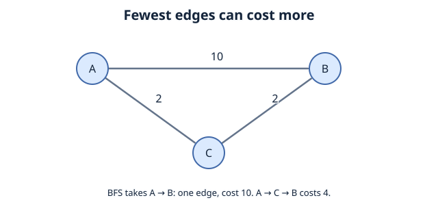

# Chapter 7: Greedy Algorithm and Optimization
We defined pathfinding as getting from a starting point A to a target B. What changes when routes have different costs?
Suppose A to B costs 10, while A to C to B costs 4. BFS finds the one-edge route first because it minimizes the number of edges, not the total weight.

Recall:

**BFS:** explores a graph level by level. It finds a path with the fewest edges, which is a minimum-cost path when every edge has the same positive cost.
**DFS:** explores one branch deeply before backtracking. It does not guarantee the shortest path.






The second diagram is a separate example: A–B costs 2, B–D costs 9, A–C costs 3, and C–D costs 1. Greedily taking the cheapest outgoing edge gives 11; the alternative gives 4. The Dijkstra and A* code below instead uses goal G and an A–B cost of 1.
## Contents

- [1. What Is a Greedy Algorithm?](#1-what-is-a-greedy-algorithm)
- [2. Dijkstra's Algorithm](#2-dijkstras-algorithm)
- [3. A* Algorithm](#3-a-algorithm)
- [4. Efficiency and Choosing a Method](#4-efficiency-and-choosing-a-method)
- [5. Check Your Understanding](#5-check-your-understanding)
- [References](#references)
## 1. What Is a Greedy Algorithm?

What is a greedy algorithm?
A greedy algorithm is an algorithm design strategy that repeatedly makes a choice that looks best at the current moment.

An intuitive way to think about it is: "Of the options available to me right now, which seems best?"

Greedy algorithms can be efficient, but a choice that looks best right now does not always produce the best overall solution.


## 2. Dijkstra's Algorithm
Dijkstra's algorithm finds shortest paths from a starting node in a weighted graph, provided all edge weights are non-negative.

Here, shortest means smallest total weight, which could mean the fastest route, cheapest route, or shortest physical distance.

Dijkstra uses a greedy strategy, but it is different from blindly choosing the cheapest outgoing edge.
- Naive greedy approach: "Which next edge is cheapest?"
- Dijkstra: "Which unprocessed node has the smallest total known cost from the start?"
That difference is important. Dijkstra compares the cumulative cost of reaching nodes, not just one edge at a time.
Three things Dijkstra keeps track of
1. Distance (cost so far): The cheapest cost currently known from the starting node to each node. Initially, the start has cost 0; other nodes are considered to have cost ∞ (infinity / not yet reached).
2. Priority queue: A collection that always gives us the node with the smallest current cost next. In Python, we can implement it using a min-heap (heapq).
3. Previous node (parent): Where we came from on the best route found so far. These parent links let us reconstruct the path at the end.

| Step | Node selected (lowest cost so far) | What we discover or update |
| --- | --- | --- |
| Start | `A`, cost `0` | `A = 0`; all other costs unknown |
| 1 | `A` | Reach `B` with cost `1`; reach `C` with cost `3` |
| 2 | `B`, cost `1` | Reach `G` with cost `1 + 10 = 11` |
| 3 | `C`, cost `3` | Find a **better** route to `G`: `3 + 1 = 4` (replace `11`) |
| 4 | `G`, cost `4` | Destination reached with its optimal cost |


Dijkstra initially discovers a route to G costing 11, but does not immediately assume it is optimal. When it explores C, it updates the best known cost to 4.

### 2.1 Implementation (Python)
The graph maps each string vertex label to a list of `(neighbor, cost)` pairs. Costs must be finite, non-negative numbers. Each listed edge is directed; add its reverse if the connection is undirected. `None` is reserved for the end of a parent chain.

```python
import heapq
from math import isfinite

def dijkstra(graph, start, goal):
    # Check all weights before an early return at the goal can hide a bad edge.
    for edges in graph.values():
        for neighbor, edge_cost in edges:
            if not isfinite(edge_cost) or edge_cost < 0:
                raise ValueError("Dijkstra requires finite, non-negative weights")

    frontier = [(0, start)]
    best_cost = {start: 0}
    parent = {start: None}

    while frontier:
        current_cost, current = heapq.heappop(frontier)

        if current_cost > best_cost[current]:
            continue

        if current == goal:
            path = []
            while current is not None:
                path.append(current)
                current = parent[current]
            return path[::-1], current_cost

        for neighbor, edge_cost in graph.get(current, []):
            new_cost = current_cost + edge_cost

            if new_cost < best_cost.get(neighbor, float("inf")):
                best_cost[neighbor] = new_cost
                parent[neighbor] = current
                heapq.heappush(frontier, (new_cost, neighbor))

    return [], float("inf") 

graph = {
    "A": [("B", 1), ("C", 3)],
    "B": [("G", 10)],
    "C": [("G", 1)],
    "G": []
}

path, cost = dijkstra(graph, "A", "G")
print("Path:", path)
print("Total cost:", cost)
```

Expected output:

```text
Path: ['A', 'C', 'G']
Total cost: 4
```

The goal is final only when it is removed from the priority queue with its best cost, not when it is first discovered. If no route exists, the function returns `([], infinity)`. If start equals goal, it returns `([start], 0)` for a valid graph.

## 3. A* Algorithm

A* (A-Star): Using an Estimate to Guide the Search
Dijkstra is useful, but imagine a very large map with thousands of intersections. Dijkstra searches outward according to the cheapest cost from the start, even when some directions do not look promising for reaching the destination.

What if we could give our algorithm a reasonable estimate of how far each node is from the goal?

That is the main idea behind A* (pronounced "A-star"). It is a form of informed best-first search: it considers both the cost of the path traveled so far and an estimate of what remains.
A* uses three values
For each node n, A* calculates:
```text
f(n) = g(n) + h(n)
```
- g(n) — Cost so far: The best known cost from the start to node n.
- h(n) — Heuristic: An estimated remaining cost from n to the goal.
- f(n) — Estimated total: The sum of g(n) and h(n).
A* normally explores the node with the smallest f(n) next.

A heuristic is an informed estimate, not a random guess. For a road map, a possible heuristic is the straight-line distance to the destination, assuming it is measured in the same cost units as the edges and never overestimates the actual travel cost.

Dijkstra found the same optimal path, but A* used the heuristic to prioritize C and did not need to expand B in this example.

To guarantee an optimal route in this finite-graph implementation, edge costs must be non-negative and the heuristic must be **admissible**: `0 <= h(n) <= true remaining cost`, with `h(goal) = 0`. An overestimate can cause A* to return a more expensive route. The code can check the numeric requirements, but cannot establish admissibility without knowing the actual remaining costs.

A **consistent** heuristic additionally satisfies `h(u) <= cost(u, v) + h(v)` on every edge. This implementation allows a vertex to be expanded again if a cheaper route to it is found, so admissible but inconsistent heuristics are supported. Setting every heuristic to zero gives Dijkstra's search priority.

### 3.1 Implementation (Python)
```python
import heapq
from math import isfinite

def a_star(graph, start, goal, heuristic):
    vertices = set(graph) | {start, goal}
    for edges in graph.values():
        for neighbor, edge_cost in edges:
            vertices.add(neighbor)
            if not isfinite(edge_cost) or edge_cost < 0:
                raise ValueError("A* requires finite, non-negative weights")
    for vertex in vertices:
        if vertex not in heuristic:
            raise ValueError("Provide a heuristic for every vertex")
        if not isfinite(heuristic[vertex]) or heuristic[vertex] < 0:
            raise ValueError("Heuristics must be finite and non-negative")
    if heuristic[goal] != 0:
        raise ValueError("The goal heuristic must be zero")

    frontier = [(heuristic[start], 0, start)]
    best_cost = {start: 0}
    parent = {start: None}

    while frontier:
        estimated_total, current_cost, current = heapq.heappop(frontier)

        if current_cost > best_cost[current]:
            continue

        if current == goal:
            path = []
            while current is not None:
                path.append(current)
                current = parent[current]
            return path[::-1], current_cost

        for neighbor, edge_cost in graph.get(current, []):
            new_cost = current_cost + edge_cost

            if new_cost < best_cost.get(neighbor, float("inf")):
                best_cost[neighbor] = new_cost
                parent[neighbor] = current

                priority = new_cost + heuristic[neighbor]
                heapq.heappush(frontier, (priority, new_cost, neighbor))

    return [], float("inf")  

graph = {
    "A": [("B", 1), ("C", 3)],
    "B": [("G", 10)],
    "C": [("G", 1)],
    "G": []
}

heuristic = {
    "A": 3,
    "B": 8,
    "C": 1,
    "G": 0
}

path, cost = a_star(graph, "A", "G", heuristic)
print("Path:", path)
print("Total cost:", cost)
```

Expected output is again `Path: ['A', 'C', 'G']` and `Total cost: 4`. Here B's initial priority is `1 + 8 = 9`, while C's is `3 + 1 = 4`, so C is expanded first.

## 4. Efficiency and Choosing a Method

For a finite simple graph, the heap-based Dijkstra implementation takes `O((V + E) log V)` time in the worst case, with the usual adjustment for very small graphs. This version leaves stale entries in the heap, so auxiliary space can be `O(V + E)`, rather than just `O(V)`. The upfront weight check takes `O(E)` time. A* can expand fewer vertices with a useful heuristic, but is not always faster; computing heuristics and re-expanding vertices can add work.

- Use BFS for a fewest-edge route in an unweighted graph.
- Use Dijkstra for minimum total cost with non-negative weights.
- Use A* when a suitable admissible heuristic is available.
- Neither implementation here supports negative weights. A different method, such as Bellman–Ford, is needed to handle them and detect reachable negative cycles.

## 5. Check Your Understanding

Why is choosing the cheapest outgoing edge different from Dijkstra? What happens to A* when `h(n) = 0` for every vertex?

**Answer:** Dijkstra chooses the frontier vertex with the lowest *accumulated* cost, rather than simply the cheapest next edge. With all-zero heuristics, A* prioritizes accumulated cost just as Dijkstra does.


## References

- MIT OpenCourseWare, 6.006 Introduction to Algorithms, Fall 2011, Lecture 16: Dijkstra's algorithm and non-negative edge weights.
- Poole and Mackworth, Artificial Intelligence: Foundations of Computational Agents, 3rd edition, section 3.6: admissible heuristics and A* search.
