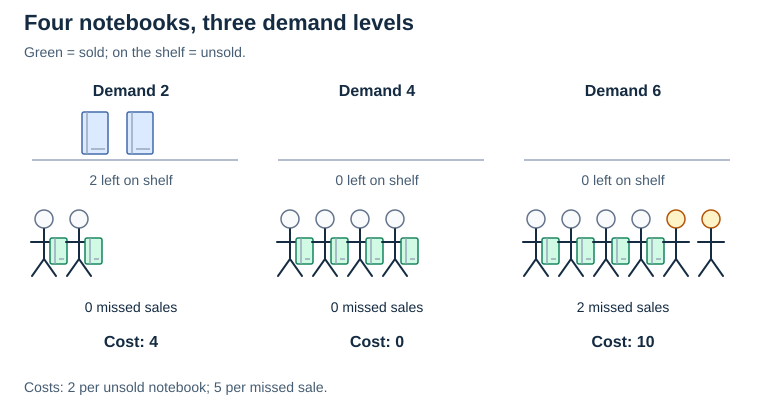
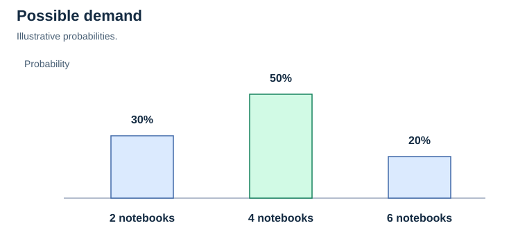
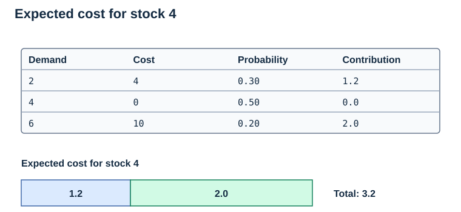
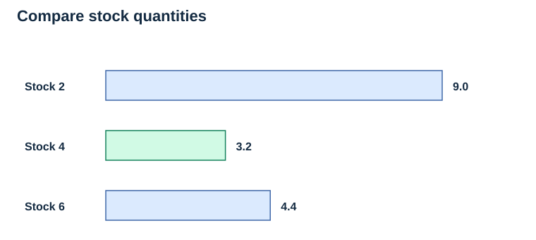
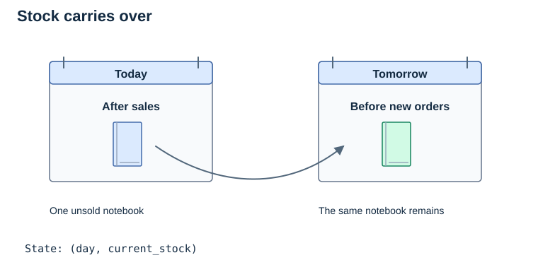

# Chapter 9: Inventory and Uncertainty Management

Algorithms are not only used to search and sort information. They can also help us decide **how to use limited resources**.

**Inventory** is the stock of products or materials that a business currently has. **Inventory management** means deciding how much stock to order, keep, or use while avoiding unnecessary costs.

Imagine you manage a small campus shop selling notebooks:

- If you order **too few**, some customers cannot buy one (**understocking**).
- If you order **too many**, you may pay to store unsold notebooks (**overstocking**).
- You need a sensible balance, not simply the biggest or smallest possible order.


## Contents

- [1. Where Do Algorithms Enter the Picture?](#1-where-do-algorithms-enter-the-picture)
- [2. Managing Uncertainty in Inventory: What If We Don't Know What Happens Next?](#2-managing-uncertainty-in-inventory-what-if-we-dont-know-what-happens-next)
- [3. Python Implementation: Compare Stock Quantities](#3-python-implementation-compare-stock-quantities)
- [4. Connecting Inventory Management to Dynamic Programming](#4-connecting-inventory-management-to-dynamic-programming)
- [Further Reading](#further-reading)
- [5. Quick Knowledge Check](#5-quick-knowledge-check)

## Further Reading

[Cornell Optimization Wiki — Newsvendor Problem](https://optimization.cbe.cornell.edu/index.php?title=Newsvendor_problem) — an introduction to single-period inventory under uncertain demand.

[Data-driven newsvendor problem](https://doi.org/10.1016/j.ijpe.2022.108509) — further reading about expected overstock and shortage costs.

---

---


## 1. Where Do Algorithms Enter the Picture?

The decision depends on the type of problem:

1. **A simple heuristic:** "Order what sold yesterday." This is easy, but yesterday's sales may not represent tomorrow's demand, and the rule ignores current inventory. It is not necessarily a greedy optimization algorithm, because it does not explicitly optimize a defined immediate objective.
2. **Single-day optimization:** Compare possible order quantities and choose the one with the lowest estimated cost (or highest expected profit).
3. **Dynamic programming (DP):** If inventory carries over across many days, the amount you order today changes what is available tomorrow. DP can compare decisions across a sequence of days by storing results for smaller states such as **(day, stock remaining)**.

**Important:** Inventory management is an **application/problem area**, not a specific algorithm. Greedy strategies, DP, forecasting, and other optimization methods can all be used to solve inventory problems.

---

## 2. Managing Uncertainty in Inventory: What If We Don't Know What Happens Next?

There is an extra complication in our notebook shop: **we do not know exactly how many people will buy a notebook tomorrow**.

That is **uncertainty**—we must make a decision before knowing the future outcome. In an algorithmic setting, *managing uncertainty* means accounting for several possible outcomes and their likelihood or consequences, rather than assuming that only one future is possible.

For example, suppose we estimate tomorrow's demand as follows. These probabilities are **made up for learning purposes**:

| Demand tomorrow | Estimated probability |
| --- | ---: |
| 2 notebooks | 30% |
| 4 notebooks | 50% |
| 6 notebooks | 20% |



Let's also assume:

- Each unsold notebook costs us **2 units** in extra costs.
- Each customer we cannot serve costs us **5 units** in missed opportunity.
- We may choose to stock **2, 4, or 6** notebooks.

For this one-day example, assume we begin with **zero stock**, receive the order before sales start, and cannot replenish during the day. The two costs are total per-unit penalties for excess stock and unmet demand; other costs and profits are excluded. Thus the order quantity equals the stock available for sale here. If stock already exists, ordering four more notebooks is different from stocking four in total.

For any one possible demand:

```text
If stock > demand: cost = (stock - demand) × 2
If demand > stock: cost = (demand - stock) × 5
If stock = demand: cost = 0
```

But we don't know which demand will happen. Instead, we calculate the **expected cost**: multiply each possible cost by the probability of that outcome, then add the results.

**For example, if we stock 4 notebooks:**

- Demand 2 (30% chance): 2 unsold × 2 = cost 4.
- Demand 4 (50% chance): cost 0.
- Demand 6 (20% chance): 2 missed sales × 5 = cost 10.



[Static version for print](../../../Assets/Algorithms/Static/inventory-demand-six.svg)

```text
Expected cost = 0.30 × 4 + 0.50 × 0 + 0.20 × 10
              = 1.2 + 0 + 2
              = 3.2
```



Let's compare the alternatives:

| Stock ordered | Expected cost |
| ---: | ---: |
| 2 | 9.0 |
| 4 | 3.2 |
| 6 | 4.4 |



With these **specific assumptions**, stocking **4 notebooks** gives the lowest expected cost among the three choices. This does **not** guarantee tomorrow's cost will be 3.2; it is an average cost across the possible outcomes, weighted by their probabilities.

## 3. Python Implementation: Compare Stock Quantities

```python
# Illustrative probabilities, not real demand forecasts.
demand_probabilities = {2: 0.30, 4: 0.50, 6: 0.20}
possible_stock = [2, 4, 6]
overstock_cost = 2
understock_cost = 5


def expected_cost(stock):
    total = 0.0

    for demand, probability in demand_probabilities.items():
        unsold = max(stock - demand, 0)
        missed_sales = max(demand - stock, 0)

        cost = (unsold * overstock_cost +
                missed_sales * understock_cost)
        total += probability * cost

    return total


for stock in possible_stock:
    print(f"Stock {stock}: expected cost = {expected_cost(stock):.1f}")

best_stock = min(possible_stock, key=expected_cost)
print(f"Best stock quantity: {best_stock}")
```

Expected output:

```text
Stock 2: expected cost = 9.0
Stock 4: expected cost = 3.2
Stock 6: expected cost = 4.4
Best stock quantity: 4
```

This code simply **evaluates possible decisions**; it is **not a dynamic programming implementation**. It introduces the idea of making decisions using expected outcomes.

## 4. Connecting Inventory Management to Dynamic Programming

Now imagine the shop needs to plan for **seven days**, and leftover notebooks remain available the next morning.

- Our **state** might be `(day, current_stock)`.
- Our **decision** might be `how many notebooks to order`.
- Our **uncertain outcome** is `how many notebooks customers buy`.
- Our **goal** might be to minimize the expected total cost across all seven days.



DP can calculate the best future expected cost for each state, so it does not have to solve the same situation repeatedly. When future demand is random, this is an example of **stochastic dynamic programming** (DP with uncertainty).

For example, if deliveries arrive immediately and unmet demand is lost rather than carried forward, the next stock is `max(current_stock + order - demand, 0)`. The demand distribution for each day must be supplied or estimated. Delivery delays or backorders require extra state information, such as outstanding orders or unmet demand; `(day, current_stock)` alone would then be insufficient. End-of-horizon leftover value or disposal cost must also be specified.

Here is the distinction:

| Concept | Main question |
| --- | --- |
| Greedy algorithms | What is the best-looking choice **right now**? |
| Dynamic programming | What is the best overall plan when decisions affect **later steps**? |
| Inventory management | How much stock should we order or keep? |
| Uncertainty management | How do we decide when **future outcomes are unknown**? |

**Key takeaway:** Inventory management and uncertainty management are **real-world problems/considerations**, while greedy algorithms and dynamic programming are **algorithm design methods** that can help address them. They often overlap, but they are not four algorithms of the same type.

## 5. Quick Knowledge Check

1. What is the difference between **overstocking** and **understocking**?
2. Why might ordering exactly what sold yesterday be unreliable?
3. When we calculate **expected cost**, why do we multiply each possible cost by its probability?
4. In the Python example, which stock quantity has the smallest expected cost?
5. Why might planning inventory for seven days require a different approach from choosing tomorrow's quantity?

### 5.1 Answers

1. Overstocking leaves excess items; understocking leaves some demand unmet.
2. Demand can change, yesterday's sales can be limited by stock-outs, and existing stock also matters.
3. Expected cost is a probability-weighted average: more likely outcomes contribute more to the estimate.
4. Stocking four notebooks has the lowest expected cost, `3.2`, among the three permitted choices.
5. Leftovers and future orders link the days, so today's lowest immediate cost may not give the lowest total cost.

**Summary:** Inventory management is the practical problem of balancing available stock against demand and costs. A simple rule may be enough in some situations; comparing expected costs helps when demand is uncertain; and dynamic programming can help when inventory decisions affect many future days.
