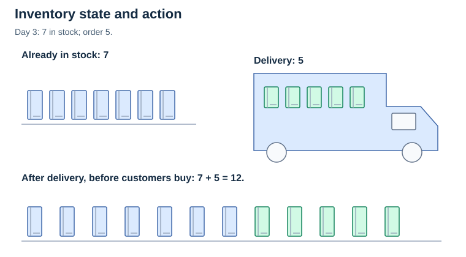
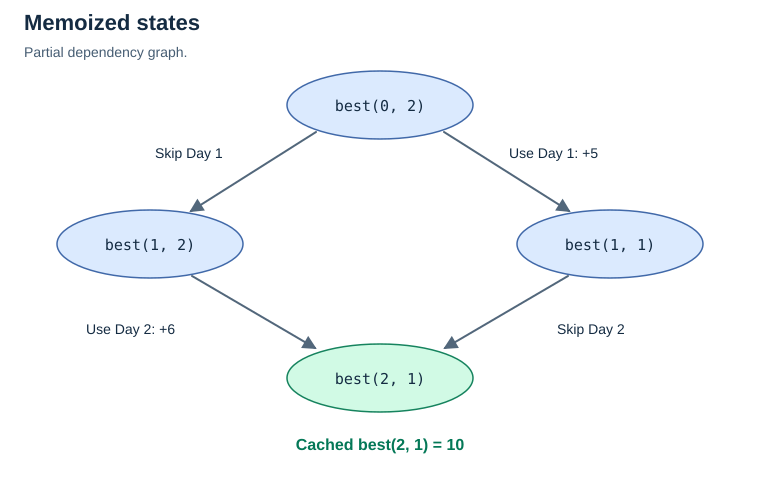
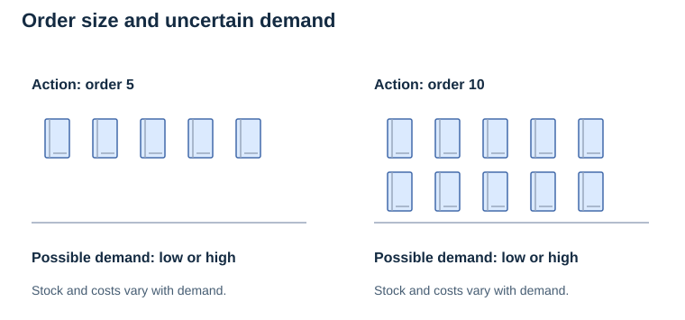

# Chapter 10: Sequential Decisions Over Time

> **Big idea:** Some decisions cannot be judged independently. What we choose **now** changes the options available **later**.

We have already seen algorithms that sort data, search graphs, and find routes. But algorithms can also help us **make a series of connected decisions** instead of just finding one answer.

Imagine you have a limited number of resources and several days to use them. Should you spend those resources immediately, or save them for an opportunity that might be more valuable tomorrow?

This is a **sequential decision problem**: we must make a choice at one step, update our situation, and then make another choice based on what remains.

---
## Contents

- [1. What Makes a Decision *Sequential*?](#1-what-makes-a-decision-sequential)
- [2. The Building Blocks](#2-the-building-blocks)
- [3. Why Isn't a Greedy Choice Always Enough?](#3-why-isnt-a-greedy-choice-always-enough)
- [4. Connection to Dynamic Programming (DP)](#4-connection-to-dynamic-programming-dp)
- [5. Python Implementation: Planning Several Decisions](#5-python-implementation-planning-several-decisions)
- [6. What If the Future Is Uncertain?](#6-what-if-the-future-is-uncertain)
- [7. Connecting This to Earlier Topics](#7-connecting-this-to-earlier-topics)
- [8. Knowledge Check](#8-knowledge-check)
- [Summary](#summary)
- [References](#references)

## Summary

**Sequential decision-making** is about making a series of connected choices where each action can affect later opportunities. Greedy rules consider a local choice; dynamic programming can compare complete future outcomes when the problem has the right structure. When future outcomes are uncertain, probability-based models such as MDPs help us compare the **expected consequences** of different actions.

**Main takeaway:** Do not ask only, *"What looks best now?"* Also ask, *"How will this choice change what I can do next?"*
## 1. What Makes a Decision *Sequential*?

A **one-time decision** is made once. A **sequential decision** happens over several steps, and earlier choices can affect later ones.

For example:

- **Pathfinding:** Which node should we explore next? That affects where we can go afterward.
- **Inventory:** How many items should a shop order today? Leftover stock changes tomorrow's options.
- **Resource planning:** Should we use a limited resource today or keep it for a more valuable task later?

A typical sequence looks like this:

```text
Current situation (state)
          |
          v
   Choose an action
          |
          v
   Receive a result
          |
          v
   Situation changes
          |
          v
   Make the next decision
          |
         ...
```

**The challenge:** An action that looks good immediately might cause a worse result overall.

---

## 2. The Building Blocks

To describe a sequential decision problem, we usually identify these parts:

| Term | Intuitive meaning | Example: shop inventory |
| --- | --- | --- |
| **State** | What we know about the current situation | Day 3; 7 notebooks in stock |
| **Action** | A choice we can make | Order 5 notebooks |
| **Transition** | How the situation changes after that choice | Stock rises after delivery, then falls as customers buy |
| **Reward or cost** | What we gain or lose | Sales profit, ordering cost, storage cost |
| **Time horizon** | How many decision steps we are planning for | The next 7 days |
| **Objective** | What we want to achieve | Highest total profit or lowest total cost |

We can also talk about a **policy**: a rule that tells us which action to take in each possible state. For example, *"If stock is below 5, order more"* is a simple policy.

The point isn't to memorize terminology immediately. It is to notice that we are no longer evaluating just one action—we are evaluating **a sequence of actions and their combined consequences**.



---

## 3. Why Isn't a Greedy Choice Always Enough?

Recall that a **greedy algorithm** makes a choice based on what looks best at the current step, without necessarily comparing every possible future consequence.

Consider this deliberately simple example.

You have **2 passes** that can each be used to attend one activity. There are three days, and each day offers one activity worth a different number of points:

| Day | Points earned if you use a pass |
| --- | ---: |
| 1 | 5 |
| 2 | 6 |
| 3 | 10 |

You cannot save a pass after Day 3.

A shortsighted rule like *"use a pass whenever today's activity gives positive points"* would choose:

```text
Day 1: use a pass  -> +5 points  (1 pass left)
Day 2: use a pass  -> +6 points  (0 passes left)
Day 3: cannot join -> +0 points
                           ------
                      Total = 11
```

But suppose we look at the entire three-day problem:

```text
Day 1: save a pass -> +0 points (2 passes left)
Day 2: use a pass  -> +6 points (1 pass left)
Day 3: use a pass  -> +10 points (0 passes left)
                           ------
                      Total = 16
```

**16 > 11.** Waiting was better in this case.



[Static version for print](../../../Assets/Algorithms/Static/sequential-pass-plans.svg)

**Important distinction:** This example shows why one *particular shortsighted rule* fails. It does **not** mean that every greedy algorithm fails on this problem; if all future values are known, we could simply select the two largest values.

---

## 4. Connection to Dynamic Programming (DP)

What if we had 30 days, a limited number of passes, and many different possible choices?

Trying every sequence of choices could become expensive. **Dynamic programming** helps when a problem can be divided into smaller, overlapping subproblems and optimal solutions can be built from their results.

Instead of asking:

> "What should I do on every single day all at once?"

We can ask:

> "If I am on a particular day with a certain number of passes left, what is the best total score I can still earn?"

That smaller question is defined by a **state**:

```text
(day, passes_left)
```

For each state, we consider two possible actions:

1. **Skip today:** Keep all passes and move to tomorrow.
2. **Use a pass:** Earn today's points, use one pass, and move to tomorrow.

Choose whichever action gives the larger **total future score**, not merely the larger immediate score.

### 4.1 The DP Recurrence

Let `best(day, passes_left)` be the maximum score obtainable from this day onward.

```text
Skip = best(day + 1, passes_left)

Use  = points[day] + best(day + 1, passes_left - 1)
       (only if passes_left > 0)

best(day, passes_left) = max(Skip, Use)
```

**Base case:** Once there are no days left, no more points can be earned; return `0`.

This is a version of the **Bellman principle of optimality**: to make the best decision now, compare the immediate result **plus the best possible result afterward**.



[Static version for print](../../../Assets/Algorithms/Static/sequential-dp-table.svg)

---

## 5. Python Implementation: Planning Several Decisions

The following implementation uses **recursion with memoization**, so repeated states are computed only once. It assumes at most one activity per day, known finite numerical rewards, and a non-negative integer number of passes. Skipping is allowed, so a negative-reward activity need not be chosen.

```python
from functools import lru_cache

# Each day's reward is known in advance for this example.
points = [5, 6, 10]
starting_passes = 2

if not isinstance(starting_passes, int) or starting_passes < 0:
    raise ValueError("starting_passes must be a non-negative integer")

@lru_cache(maxsize=None)
def best(day, passes_left):
    # No days or usable passes remain.
    if day >= len(points) or passes_left == 0:
        return 0

    # Choice 1: Do not use a pass today.
    skip_today = best(day + 1, passes_left)

    # Choice 2: Use a pass today (if one is available).
    use_today = float('-inf')
    if passes_left > 0:
        use_today = points[day] + best(day + 1, passes_left - 1)

    return max(skip_today, use_today)

maximum_points = best(0, starting_passes)

# Find an optimal decision sequence using the computed DP values.
passes_left = starting_passes
chosen_days = []

for day in range(len(points)):
    skip_today = best(day + 1, passes_left)
    use_today = float('-inf')

    if passes_left > 0:
        use_today = points[day] + best(day + 1, passes_left - 1)

    if use_today > skip_today:
        chosen_days.append(day + 1)  # Convert 0-based index to day number
        passes_left -= 1

print('Maximum points:', maximum_points)
print('Use passes on days:', chosen_days)
```

Expected output:

```text
Maximum points: 16
Use passes on days: [2, 3]
```

### 5.1 How Does the Code Work?

- `best(0, 2)` asks: *What is the highest score from Day 1 onward if we have two passes?*
- For each day, the function compares **skipping** with **using** a pass.
- `@lru_cache` remembers the result for each `(day, passes_left)` pair, avoiding repeated calculations.
- In a tie, the reconstruction skips today; another optimal sequence may also exist. If no passes or days remain, the best future score is zero.
- Run the whole block again when changing `points`, or call `best.cache_clear()` before recalculating. The cache keys contain only the function arguments, not the global `points` list, so changing that list alone can leave stale answers.


- After calculating the optimal score, the second loop reconstructs one optimal sequence of decisions.

With `D` days and `P` starting passes, there are at most `O((D + 1)(P + 1))` distinct states, with constant work per state in the fixed-size-number model. Including the `O(D)` reconstruction, this is `O(D(P + 1))` time for `D >= 1`; using `P + 1` keeps the bound meaningful when there are zero passes. Memoization uses at most `O((D + 1)(P + 1))` space, recursion up to `O(D)` call-stack space, and the chosen-day list up to `O(min(D, P))` space. The actual state count can be smaller. A long horizon can exceed Python's recursion limit; bottom-up tabulation avoids it.

---

## 6. What If the Future Is Uncertain?

So far, we assumed we **knew in advance** how many points each day was worth.

Real decisions are often more complicated:

- A store does not know exactly how many customers will arrive tomorrow.
- A delivery service cannot perfectly predict traffic.
- A robot may not know whether an attempted movement will succeed.

Now the next state may depend on **chance**, not just our chosen action.

This leads to **decision-making under uncertainty**.

### 6.1 A Simple Example

Imagine a shop deciding whether to order notebooks. The action is **order 5** or **order 10**, but tomorrow's demand could be low or high.

```text
                 Decide how many to order
                           |
                +----------+----------+
                |                     |
             Order 5               Order 10
                |                     |
          Demand varies         Demand varies
                |                     |
          Different stock       Different stock
          and costs tomorrow    and costs tomorrow
```

Instead of planning for one guaranteed future, we can evaluate **possible futures and their probabilities**.



If the probabilities are known or estimated, a typical goal is to maximize **expected total reward** (or minimize expected total cost). We calculate the average outcome weighted by the probabilities—not a guaranteed result.

A framework often used for this is a **Markov Decision Process (MDP)**:

- **States:** possible situations
- **Actions:** choices available in each situation
- **Transition probabilities:** chances of moving to different next states
- **Rewards:** value gained or lost
- **Policy:** which action to take in each state

The **Markov assumption** means that, given the current state and chosen action, the model does not need the complete earlier history to describe what happens next. This only works if the state contains the relevant information.

For a finite number of steps, the stochastic DP idea can be summarized as:

```text
Best value now =
    best choice of (
        immediate reward
        + expected best value of the next state
    )
```

In mathematical notation, for rewards measured at each step:

```text
V_t(s) = max over available actions a of
         [R_t(s, a) + sum over next states s' of P(s' | s, a) * V_(t+1)(s')]
```

where `V_t(s)` is the best expected future reward at time `t` in state `s`; `a` is an available action; `R_t` is its immediate expected reward; and `P` describes possible next states. This basic form assumes a finite time horizon with no discount factor.

At the terminal time `T`, specify `V_T(s)`: it is zero if nothing more is gained or lost, or a terminal value such as the salvage value of remaining inventory. The transition probabilities for each state-action pair must sum to one. If dynamics change by day, write them as `P_t(s' | s, a)` or include the day in the state.

**You do not need to memorize the equation yet.** The central idea is simply that a good decision weighs **what happens now and what may happen later**.

---

## 7. Connecting This to Earlier Topics

| Topic | Connection to sequential decisions |
| --- | --- |
| **Greedy algorithms** | Choose based on a current rule; sometimes optimal, sometimes not |
| **Recursion** | Solve today's decision using answers for smaller future problems |
| **Dynamic programming** | Reuse answers for repeated states to find an optimal plan |
| **Graph search / pathfinding** | A route is a sequence of moves; the current location influences available moves |
| **Dijkstra / A\*** | Find minimum-cost routes; both consider information accumulated across a route, rather than merely choosing the cheapest outgoing edge |
| **Inventory management** | Today's order affects tomorrow's remaining stock and costs |
| **Uncertainty management** | Evaluate possible next states instead of assuming one known outcome |

**Note:** Not every sequential decision problem needs dynamic programming. Some have a correct greedy solution; others use graph algorithms, mathematical optimization, or learning-based methods.

---

## 8. Knowledge Check

1. What makes a **sequential** decision different from a one-time decision?
2. In the three-day passes example, what is the **state**? What are the two **actions**?
3. Why does using passes on the first two days give a worse total than using them on Days 2 and 3?
4. What does `best(day, passes_left)` represent?
5. Why do we use `@lru_cache` in the Python example?
6. How does **uncertainty** change the way we plan future decisions?
7. Is an MDP itself the same thing as Dijkstra's algorithm? Why or why not?

### 8.1 Answers

1. Earlier choices change the state and available choices at later steps.
2. The state is `(day, passes_left)`. The actions are skip, or use one pass if available.
3. Days 1 and 2 give `5 + 6 = 11`; Days 2 and 3 give `6 + 10 = 16`.
4. The maximum total points obtainable from that day onward with the stated passes remaining.
5. It saves answers for repeated states so they are not recomputed.
6. We consider possible outcomes and their probabilities, rather than assuming one certain next state.
7. No. An MDP models states, actions, probabilistic transitions, and rewards. Dijkstra is a particular algorithm for shortest paths with non-negative weights.

---


## References

- MIT OpenCourseWare, 6.006 Introduction to Algorithms, Fall 2011, Lectures 19–22: states, recurrences, and dynamic programming.
- Python Software Foundation, `functools.lru_cache` documentation: caching function results and clearing cached values.
