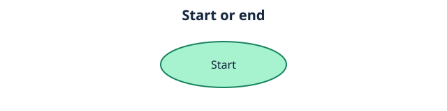
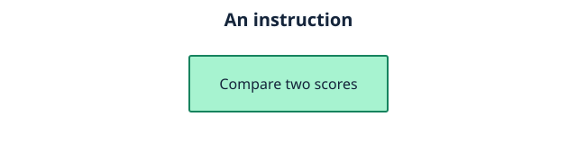
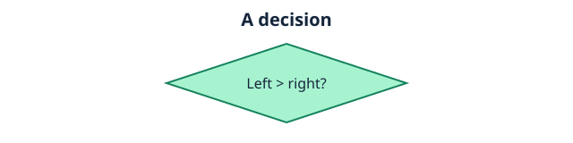
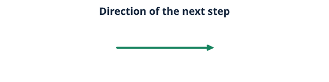
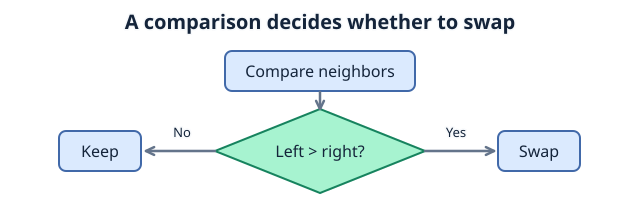

# Introduction to Algorithms
## What Are Algorithms?
### Definition of an Algorithm
an **algorithm** is a sequence of precise, dfined instructions designed to solve a particular problem or complete a task (ie.automation,etc)

At its core, algorithms takes an input (data provided whether it be sorted or unsorted), processes it through a series of instructions, and produces an output.

Though, its important to note that a **program** != an **algorithm**

---

## Examples
lets consider the <u>process</u>  of sorting student's grades in ascening order.

given  an array of integers (scores) **[72,85,40,29,100,91]**, we can sort these 'scores' in ascending order by constructing an algorithm that compares the first position,**n**, with the next position,**n+1**, and check whether n>n+1. naturally, the largest number will "bubble" itself up to the end of the array.

## Implementation
### in python
### example:
```
grades = [72,85,40,29,100,91]
length = len(grades)
for i in range(length):
    for j in range(0, length-1-i):
        if grades[j] > grades[j+1]:
            grades[j], grades[j+1] = grades[j+1], grades[j]
print("Sorted array: \n" + str(grades))
```
the result: [29,40,72,85,91,100]
notice how < and > are interchangable, simply changing the rational operator can sort the array in descending OR ascending order.
This is an example of an algorithm, it uses a sequence of precise commands to complete a task (sorting numbers).


## Importance of Algorithms in Programming
Algorithms provide a structured approach to solving problems.

They help:

* Solve problems systematically by breaking complex problems into smaller, manageable steps.
* Provide methods for solving problems.
* Reuse solutions: Once implemented, you can apply established problem solving methods to different problems.
---
Different algorithms can solve the same problem using different approaches.

Lets take a pathfinding/navigation application for example. an algorithm can evaluate several possible routes between two locations. one algorithm might explore all/many possible routes, while another prioritizes routes that are closer or **appear** closer. (BFS or Djikstra's) algorithm.

## Characteristics of an Algorithm
**Input:** Accepts >= 0 values or pieces of information

**Output:** Produces a definite result.

**Definition:** Instructions are clear,precise, unambigious.

**Finite:** Algorithms terminates after a finite number of steps/time it does not run indefinetely.

Simply telling a computer to "sort these numbers" or "find the best route" is not a complete algorithm, because it does not explain how the numbers should be sorted, or how routes should be evaluated.

## Describing an Algorithm
Consider the python code example in 1.2. 

We can sort them in ascending order by describing them in detailed steps:

**1. Look at the very first number**

**2. Examine the next number adjacent to it.**

**3. IF number is greater/larger then we swap**

**4. Repeat until every number has been examined**

**5. Return the sorted array**

## Visualization
Consider the following list:
**[72,85,91,68]**

### The bubble sort algorithm processes the values as follows:


```initial list:
[72] [85] [91] [68]

Pass 1:
[72] [85] [91] [68]
  ^    ^
72 > 85 == False. No swap.

[72] [85] [91] [68]
       ^    ^
85 > 91 == False. No swap.

[72] [85] [91] [68]
           ^    ^
91 > 68 == True. Swap!
Result of Pass 1: [72] [85] [68] [91] (91 bubbles to the end)

Pass 2:
[72] [85] [68] [91]
  ^    ^
72 > 85 == False. No swap.

[72] [85] [68] [91]
       ^    ^
85 > 68 == True. Swap!
Result of Pass 2: [72] [68] [85] [91] (85 bubbles to its place)

Pass 3:
[72] [68] [85] [91]
  ^    ^
72 > 68 == True. Swap!
Result of Pass 3: [68] [72] [85] [91]

Final output:
[68] [72] [85] [91]
```


### At its core, this is how an algorithm gradually processes input data until it produces the expected result.

## Representing Algorithms
Algorithms can be represented in several ways, including natural language,pseudocode, and flowcharts.

### Pseudocode
Informal,programming-like way of describing an algorithm without following the exact syntax of a particular programming language.

pseudocode does not have a universal syntax. Recall the [sorting example](#implementation), we can represent sorting numbers in a nonempty list in pseudocode:
```python
Set grades to [72,85,40,29,100,91]
for i from 0 to length - 1
    for j from 0 to length - 1 - i
        if grades[j] > grades[j+1] then
            swap grades[j] with grades[j+1]
        END if
    END FOR
END FOR
print "Sorted array: " and grades
```

### Flowcharts
A flowchart represents an algorithm using connected shapes and arros.

### Flowchart symbols:
* oval: start/end

  

* Rectangle: Operation/Instruction

  

* Diamond: Condition/Decision

  

* Arrow: Direction the algorithm proceeds.

  


