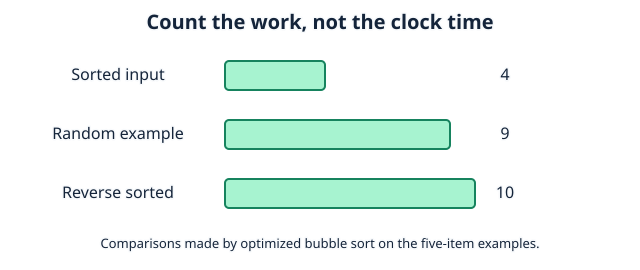

# Basic Sorting Algorithms

## Improving Bubble Sort
Suppose our grades were already sorted
```
[29, 40, 72, 85, 91, 100]
```
our original approach **still** performs its comparisons/checks completely. So how do we go about improving it?

the solution is actually straightforward; we can simply record whether any swaps happens during a pass. if a complete pass makes no swap then we automatically know that every number is sorted.
```python
grades = [72, 85, 40, 29, 100, 91]
length = len(grades)

for i in range(length - 1):
    swapped = False

    for j in range(length - 1 - i):
        if grades[j] > grades[j + 1]:
            grades[j], grades[j + 1] = grades[j + 1], grades[j]
            swapped = True

    if not swapped:
        break

print(grades)
```
we significantlly improved the efficiency of our algorithm, so what can we take away from this?



## Efficiency
when comparing efficiency, ask yourself:

* how many items are checked?
* How many comparisons/movements are made?
* How much information must be stored while its working?

Sorting our list of grades in ascending order with bubble sort gives different amounts of work for how "out of order" the initial list is. 

|| Initial Data Condition | Comparisons Made | Swaps Made |
:--- | :--- | :--- | :--- |
|  | `[55, 65, 75, 85, 95]` Already sorted | 4 | 0 |
|  | `[75, 55, 95, 65, 85]` Random order | 10 | 5 |
|  | `[95, 85, 75, 65, 55]` Reverse sorted | 10 | 10 |

The easiest situation is our **best case.**

The hardest situation requiring the most work is our **worst case**

Our **average case** depends on assumptions about which inputs are likely.



## Same Problem, Different Algorithms
recall the same problem, we have a list of grades, and want to sort it in ascending order:
```
[72,85,91,68] 
```
in [Introduction to Algorithms](01%20introduction%20to%20algorithms.md) we primarily used Bubble sorting which compares adjacent numbers, and swaps them if they are in the wrong order, now we can introduce another sorting algorithm.
## Selection Sort
1. Look at the very first index, store whatever value is inside as the minimum
2. Use the stored minimum value and go through the array, comparing the values
3. Each time a smaller number than the minimum appears, update it to be the new minimum and keep going through the array until there are no numbers smaller than the minimum.
4. Swap the positions
5. Go to the next index, assign it as the new minimum

6. Repeat




## Insertion Sort
remember our array [72,85,91,68]

1. Skip the first index [0], a single  element is always sorted.
2. Examine the next element, store it at the current index as our current value. we call this value the **key**.
3. Compare the key with the element to its left, if its smaller then shift that element to the right.
4. Keep comparing the key to its left until the key is greater than the element or you reach the start of the array
5. **Insert** the key into the empty position.
6. move to the next index, repeat the process until the elements have been inserted into its correct position.

in a sense were creating a partition to divide the left side into the sorted portion, and the right side into the unsorted portion.
