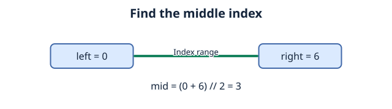
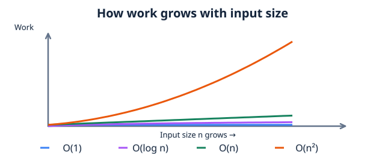

# Binary Search, Linear Search, and Big O Notation

## Linear Search
if sorting arranges items, searching finds a particular item.

Linear search, at its core is essentially a way to find a target by examining elements one by one.

#### given an array of integers: [72,85,91,68] you're assigned to find 68.
finding 68 itself requires **4** checks, finding 91 requires **3**, finding 85 requires **2** , finding 72 requires **1**.


**Linear search**:
1. start at first index (0)
2. Compare the current element with the target.
3. If the value matches, stop searching.
4. If values doesnt match, move to the index, compare next element with target.
5. Repeat until target found



#### Implementation (python):
```
array_one = [72,85,91,68]
length_arr = len(array_one)
for i in range(length_arr):
    if array_one [i] == 68:
        print("found 68 at index" + str(i))
```
#### output: found 68 at index 3
**Important distinction:** searching is not the same as sorting, were just trying to find where the target is located.

Something else to note is the fact that linear search works whether the array is sorted or unsorted.

## Binary Search
Now ask yourself:

1. what happens as the dataset grows? what if our array has a million or more elements?

2. What happens if our target is at the end of said array?

Linear search would prove to be massively inefficient at that scale.

If Linear search checks one by one, binary search repeatedly eliminates half of remaining possibilities with one requirement:
**The dataset must be sorted**
#### given an array of integers: [1,3,5,7,9, 11, 13] we want to find the target: 11

1. Find, and examine the middle of the array.
2. Compare the value of the element with our target
3. if value is bigger than target, we can eliminate the entire right half including the value.
4. if value is smaller, eliminate entire left half, including the value.
5. Repeat until target is found or there are no elements left to search.



#### To find, and examine the middle element, think of the midpoint formula:
```
Minimum + Maximum
__________________
        2
```

in our given array, the 0'th index + the 6'th index / 2 evaluates to 3, so our middle elemnt is at index 3.

so were finding the midpoint between indices, which can be represented as:

```
mid = [left+ right / 2]
```

Left = index of first 
element in search range.

Right = End of search range

Mid = Indx of middle element



### Implementation (Python)
```python
def binary_search(arr, target):
    low = 0
    high = len(arr) - 1

    while low <= high:
        mid = (low + high) // 2
        if arr[mid] == target:
            return mid

        elif arr[mid] < target:
            low = mid + 1

        else:
            high = mid - 1
    return -1

numbers = [10, 23, 35, 42, 57, 68, 71, 85, 92]
target_value = 68

index = binary_search(numbers, target_value)
print(f"Target {target_value} found at index: {index}")
```
Output: Target 68 found at index: 5

## Big O Notation

Here, `n` is the number of input items. For operation counts and growth examples, see [Time Complexity Analysis](05%20time%20complexity%20analysis.md).

---

| Label | Reading | Example|
| --- | --- | --- |
| `O(1)` | Constant | accessing an element of an array |
| `O(log n)` | Logarithmic | Binary search|
| `O(n)` | Linear | Linear search|
| `O(n²)` | Quadratic | Bubble sort |
----



