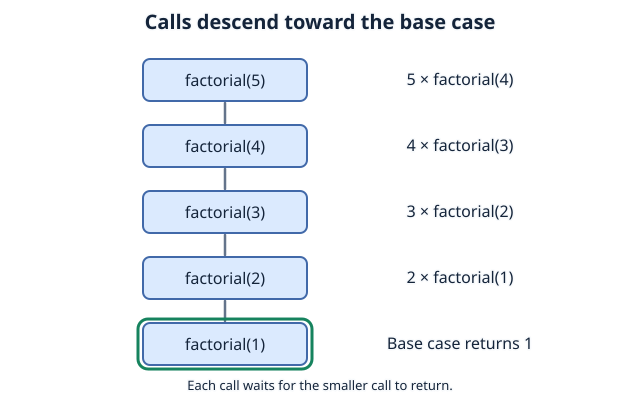
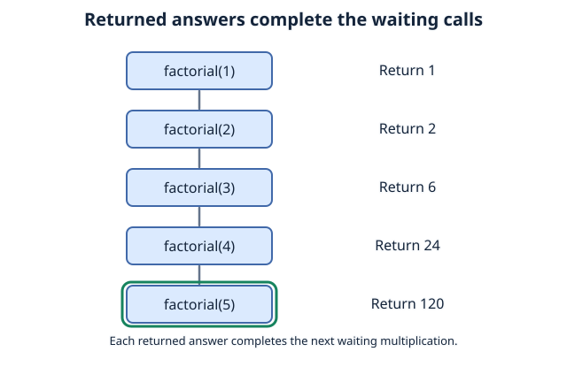

# Recursion and Call Stack
## What Is Recursion?
Heres the definition: "a **technique** where a function calls itself directly or indirectly to solve a smaller version of the problem.

Essentially, its when a function solves a problem by calling itself.

heres an introduction using assignments already given to us during our lecture about loops:

### Iterative implementation (C)
```
#include <stdio.h>
int main(void)
{
    int num1;
    long long sum = 1;
    if (scanf("%d", &num1) != 1)
    {
        printf("Invalid integer");
    }
    for (int i=1; i<=num1; i++)
    {
        sum = sum * i;
    }
    printf("%lld\n", sum);
}


```
### Recursive implementation (Python)

```
def factorial_recursive(n):
    if n < 0:
        return "Factorial is not defined for negative numbers."
    if n == 0 or n == 1:
        return 1
    return n * factorial_recursive(n - 1)

# Example usage:
print(factorial_recursive(5))  # Output: 120
```
both calculates factorials of any given integer, but one handles it differently. Lets take a closer look at the recursive implementation.

first, we need to know the components of recursions:
1. Base Case:  The simplest possible version of the problem that can be answered immediately. This stops the function from calling itself forever.
2. Recursive Case: The step where the function breaks the problem down into a smaller problems and calls itself to solve it, moving towards the base case.

Everytime the function calls itself it reaches towards the base case by reducing n by 1:


what happens after we reach the base case?


## Call Stack
Recall the [recursion example](#what-is-recursion), and ask yourself again:

1. how does the program know where it left off?
2. how does the program know which function it should return to?

Call stack: a data structure that keeps track of active function calls during a program's execution. Whenever a function is called, the program adds a new entry, known as a stack frame, to the call stack.

Every time a function calls itself, the program pushes a new stack frame, onto the call stack using a Last-in, First-out (LIFO) order.

adding a function: push

removing a function: pop

since it goes in the order of last in, first out, the newest call must be evaluated and 'popped' first (LIFO).

implementation with our factorial calculator:


When factorial(1) returns 1, its stack frame is removed.

Then factorial(2) can finish, followed by factorial(3), and so on.


----
