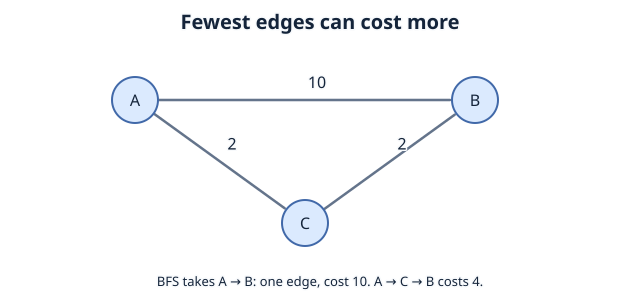

# Greedy Algorithm and Optimization
We defined pathfinding as getting from a starting point, A, to a target, B. but what if we were using a weighted graph?
say a route from A to B costs 10, and A to C to B costs 4, if we used BFS it would naturally prefer the path with the higher costs.

recall that 
**BFS:** explores a graph level by level, in an **unweighted graph**. it can find the path with the fewest edges.
**DFS:** explores one branch deeply before backtracking. It does not guarantee the shortest path.






## What Is a Greedy Algorithm?

What is a greedy algorithm?
A greedy algorithm is an algorithm design strategy that repeatedly makes a choice that looks best at the current moment.

An intuitive way to think about it is: "Of the options available to me right now, which seems best?"

Greedy algorithms can be efficient, but a choice that looks best right now does not always produce the best overall solution.


## Dijkstra's Algorithm
Dijkstra's algorithm finds shortest paths from a starting node in a weighted graph, provided all edge weights are non-negative.

Here, shortest means smallest total weight, which could mean the fastest route, cheapest route, or shortest physical distance.

Dijkstra uses a greedy strategy, but it is different from blindly choosing the cheapest outgoing edge.
- Naive greedy approach: "Which next edge is cheapest?"
- Dijkstra: "Which unprocessed node has the smallest total known cost from the start?"
That difference is important. Dijkstra compares the cumulative cost of reaching nodes, not just one edge at a time.
Three things Dijkstra keeps track of
1. Distance (cost so far): The cheapest cost currently known from the starting node to each node. Initially, the start has cost 0; other nodes are considered to have cost ∞ (infinity / not yet reached).
2. Priority queue: A collection that always gives us the node with the smallest current cost next. In Python, we can implement it using a min-heap (heapq).
3. Previous node (parent): Where we came from on the best route found so far. These parent links let us reconstruct the path at the end.

| Step | Node selected (lowest cost so far) | What we discover or update |
| --- | --- | --- |
| Start | `A`, cost `0` | `A = 0`; all other costs unknown |
| 1 | `A` | Reach `B` with cost `1`; reach `C` with cost `3` |
| 2 | `B`, cost `1` | Reach `G` with cost `1 + 10 = 11` |
| 3 | `C`, cost `3` | Find a **better** route to `G`: `3 + 1 = 4` (replace `11`) |
| 4 | `G`, cost `4` | Destination reached with its optimal cost |


Dijkstra initially discovers a route to G costing 11, but does not immediately assume it is optimal. When it explores C, it updates the best known cost to 4.

### Implementation (Python)
```python
import heapq

def dijkstra(graph, start, goal):
    frontier = [(0, start)]
    best_cost = {start: 0}
    parent = {start: None}

    while frontier:
        current_cost, current = heapq.heappop(frontier)

        if current_cost > best_cost[current]:
            continue

        if current == goal:
            path = []
            while current is not None:
                path.append(current)
                current = parent[current]
            return path[::-1], current_cost

        for neighbor, edge_cost in graph.get(current, []):
            if edge_cost < 0:
                raise ValueError("Dijkstra requires non-negative weights")

            new_cost = current_cost + edge_cost

            if new_cost < best_cost.get(neighbor, float("inf")):
                best_cost[neighbor] = new_cost
                parent[neighbor] = current
                heapq.heappush(frontier, (new_cost, neighbor))

    return [], float("inf") 

graph = {
    "A": [("B", 1), ("C", 3)],
    "B": [("G", 10)],
    "C": [("G", 1)],
    "G": []
}

path, cost = dijkstra(graph, "A", "G")
print("Path:", path)
print("Total cost:", cost)
```

## A* Algorithm

A* (A-Star): Using an Estimate to Guide the Search
Dijkstra is useful, but imagine a very large map with thousands of intersections. Dijkstra searches outward according to the cheapest cost from the start, even when some directions do not look promising for reaching the destination.

What if we could give our algorithm a reasonable estimate of how far each node is from the goal?

That is the main idea behind A* (pronounced "A-star"). It is a form of informed best-first search: it considers both the cost of the path traveled so far and an estimate of what remains.
A* uses three values
For each node n, A* calculates:
\[
f(n) = g(n) + h(n)
\]
- g(n) — Cost so far: The best known cost from the start to node n.
- h(n) — Heuristic: An estimated remaining cost from n to the goal.
- f(n) — Estimated total: The sum of g(n) and h(n).
A* normally explores the node with the smallest f(n) next.

A heuristic is an informed estimate, not a random guess. For a road map, a possible heuristic is the straight-line distance to the destination, assuming it is measured in the same cost units as the edges and never overestimates the actual travel cost.

Dijkstra found the same optimal path, but A* used the heuristic to prioritize C and did not need to expand B in this example.

### Implementation (Python)
```python
import heapq

def a_star(graph, start, goal, heuristic):
    frontier = [(heuristic[start], 0, start)]
    best_cost = {start: 0}
    parent = {start: None}

    while frontier:
        estimated_total, current_cost, current = heapq.heappop(frontier)

        if current_cost > best_cost[current]:
            continue

        if current == goal:
            path = []
            while current is not None:
                path.append(current)
                current = parent[current]
            return path[::-1], current_cost

        for neighbor, edge_cost in graph.get(current, []):
            if edge_cost < 0:
                raise ValueError("This A* example requires non-negative weights")

            new_cost = current_cost + edge_cost

            if new_cost < best_cost.get(neighbor, float("inf")):
                best_cost[neighbor] = new_cost
                parent[neighbor] = current

                priority = new_cost + heuristic[neighbor]
                heapq.heappush(frontier, (priority, new_cost, neighbor))

    return [], float("inf")  

graph = {
    "A": [("B", 1), ("C", 3)],
    "B": [("G", 10)],
    "C": [("G", 1)],
    "G": []
}

heuristic = {
    "A": 3,
    "B": 8,
    "C": 1,
    "G": 0
}

path, cost = a_star(graph, "A", "G", heuristic)
print("Path:", path)
print("Total cost:", cost)
```
