# 3.1 Pathfinding

## 3.2 Graphs
Graphs are the few foundational concepts you typically need to understand before going to pathfinding, so:
1. what are graphs?

Graphs, as explained in our **Data structure** modules is a data structure used to represent relationships.
* vertices(nodes) : locations/points/objects
* Edges: connections between those nodes/vertices.

Although this is how we read, and define them, its worth noting that there are different types of graphs, cinluding:
1. **Directed graphs.** Edges point in a particular direction.

   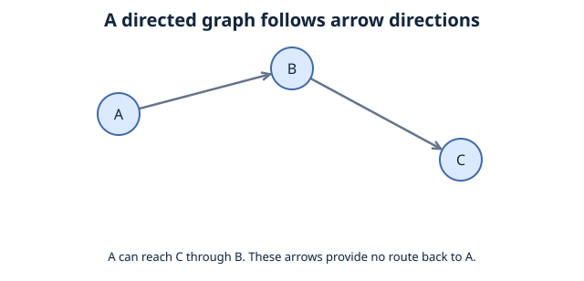

2. **Undirected graphs.** Edges connect vertices in both directions.

   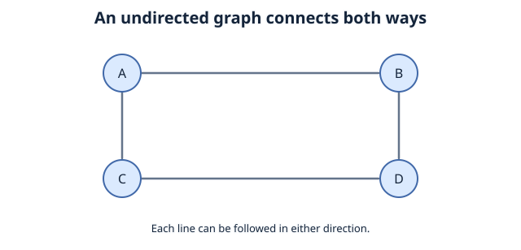

3. **Weighted graphs.** Edge weights can represent cost, distance, or time.

   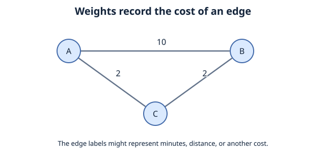

4. **Unweighted graphs.** Each edge counts as one step.

   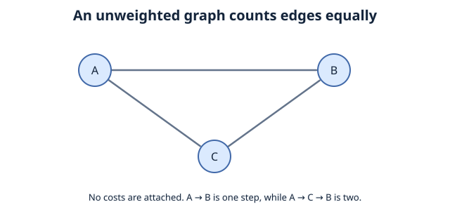

Examine our undirected graph, the vertices would be the marked points (A-D), the edges would be the lines connecting them. if we assume each letter represents different rooms, then we can assume the lines connects two rooms.

## 3.3 Graph traversal
### definition:
process of systematically visiting nodes in a graph.

specifically, were visiting, checking, and updating every node in a graph.

later on in the module, you'll see an implementation of BFS, and DFS, they're the primary algorithms used graph traversal. 


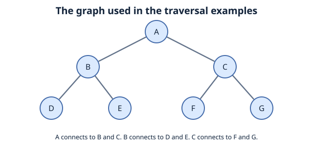

look at this specific graph as an example, and note:
**there can be multiple ways to traverse the same graph.**

we could:
1. explore all nodes at the current level, and then moves to the next level and repeat:

```
Possible traversal order:
A > B > C > D > E > F > G
A > C > B > G > F > E > D
A > B > C > E > D > G > F
```

Notice: everything starts at A, we typically call it the **Root node** , everything below is the child nod of A. D,E is the child node of the parent node B. F,G is the child node of the parent node C. 

This specific traversal order is often used by **BFS**, one of our introductory pathfinding algorithms.

Recall Module 2.5.2, if stacks operate on the principle **LIFO**, then **queue** operates on **FIFO**

**FIFO** = First in, First out. this is how **BFS** maintains this specific traversal order.

2. Explore one branch as deeply as possible before **backtracking** to explore an unvisited branch.

```
Possible traversal order:
A > B > D > E > C > F > G
A > C > G > F > B > E > D
A > B > E > D > C > F > G
```
**LIFO** = Last in, First out. This is how DFS Maintains this specific traversal order.
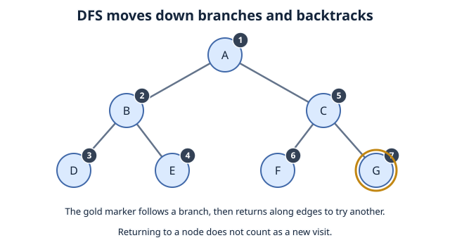

### 3.3.1 Graph searching
3.3 covered traversal but notice that during all our time finding the order in which we cna traverse the graph, we never found or ended up at a specific node or value nor did we stop exploring at a certain node.

At its core, this is what Graph searching is about.

If Graph traversal's goal is to visit and explore every node systematically, then Graph searching involves finding a specific target node or value, with a stop condition implemented as well to stop once the target is found.

Recall the possible ways to traverse through a graph and what pathfinding algorithm was associated with the order...those algorithms use graph traversal strategies, but graph searching adds a goal, target, and check.


### 3.3.2 Connection to Pathfinding

The best way to sum up pathfinding is by asking yourself how can you get from a starting point (node) A,  to an end point (target),B through all possible valid **routes**.

you can find a path, but which route is takes the fewest steps, whats the shortest path? Its important to note that not every graph searching algorithm guarantees the shortest path.

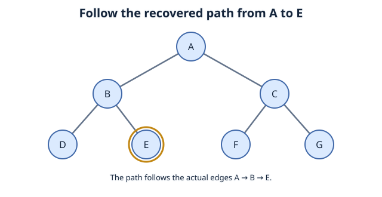

## 3.3 Pathfinding: BFS
BFS - Breadth-First Search is our first graph traversal algorithm.

### 3.3.1 **Breadth-First Search (BFS)**
* starts off from its starting node
* explores level by level
* gradually moves farther away
* can find the shortest path in an unweighted graph


uses queue (FIFO) to remember which nodes to explore next.




### Implementation (Python)
```python
from collections import deque

def bfs(graph, start_node):
    visited = set()
    queue = deque([start_node])
    
    visited.add(start_node)
    
    traversal_order = []

    while queue:
        current_node = queue.popleft()
        traversal_order.append(current_node)
        
        for neighbor in graph.get(current_node, []):
            if neighbor not in visited:
                visited.add(neighbor)
                queue.append(neighbor)
                
    return traversal_order

if __name__ == "__main__":
    graph = {
        'A': ['B', 'C'],
        'B': ['D', 'E'],
        'C': ['F'],
        'D': [],
        'E': ['F'],
        'F': []
    }
    
    print("BFS Traversal starting from 'A':")
    print(bfs(graph, 'A'))
```


### **3.3.2 Depth-First Search (DFS)**

* Start form the starting node
* explore one branch as deeply as possible
* backtrack once it reaches a dead end
* explores the next unvisited branch
* repeat until every branch/path has been explored or it finds its target
* Dosnt guarantee shortest path


Uses a stack (LIFO), **Last In, First Out**.

Typically uses **Recursion**
```python
def dfs_recursive(graph, source, visited=None):
    if visited is None:
        visited = set()
    visited.add(source)
    print(source, end=" ")
    for neighbor in graph[source]:
        if neighbor not in visited:
            dfs_recursive(graph, neighbor, visited)
```


### 3.3.3 DFS vs BFS
**DFS:**
* Most commonly implemented with recursion
* Uses a stack (LIFO), **Last In, First Out**.
* Explores deeply, not level by level
* it can find a longer path and finish, it does not guarantee the shortest possible path

**BFS:**
* Uses a queue (FIFO), **First In, First Out**.
* explores level by level
* guarantees the shortest possible path **(in unweighted graphs)**


Differentiate Graph Traversal, graph searching, and pathfinding from one another. They are closely related but not the same.

Pathfinding: getting from a starting point to an end point (A to B)

Graph traversal: systematically visiting nodes in a graph.

### 3.3.4 Greedy algorithms
We defined pathfinding as getting from a starting point, A, to a target, B. but what if we were using a weighted graph?
say a route from A to B costs 10, and A to C to B costs 4, if we used BFS it would naturally prefer the path with the higher costs.


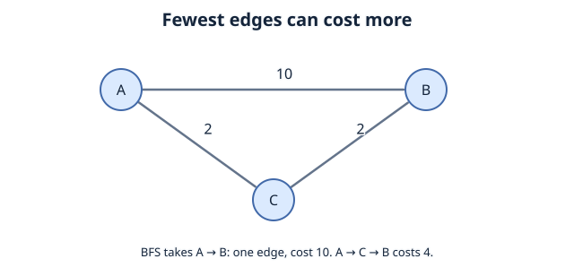

