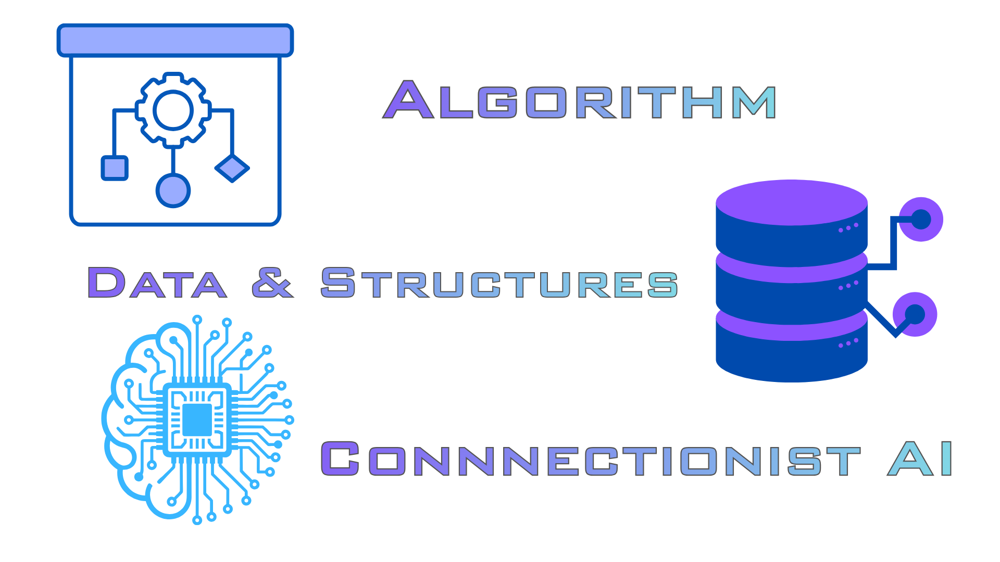

# B.O.T.A.K - Algorithms, Data Structures & Connectionist AI

**Module:** Algorithms, Data Structures, and Connectionist AI

**Team:** B.O.T.A.K Group

**Stage:** Stage 1 [Rough Plan]

**Last Updated:** 29-10-2026

**Repository:** [SkibidiRizzBOTAKgroup](https://github.com/NickyCoz/SkibidiRizzBOTAKgroup)

This project aims to develop a structured learning resource for a complete beginner. It is designed to help beginners understand the basics of algorithm, data structures, and connectionist AI through PPT Slides, Video tutorials and live mini lecture as an organized explanations.

## Useful URLs
| Document                | Link                                                                                             |
|-------------------------|--------------------------------------------------------------------------------------------------|
| Team Plan               | https://docs.google.com/document/d/1U50U_jeq3KvxRDXLdnDo-3uPPYY5omWWu4-0gd9eDdw/edit?usp=sharing |
| Project Log             | https://docs.google.com/document/d/1VH_XdAuV1Oy1ouvihMrde1bBLtVQFD4dVXinCWRPKaI/edit?usp=sharing |
| Meeting Log             | https://docs.google.com/document/d/1aB8WqSrxUUA-k8mu3gx3yitoVY7Ehh_uSgFoI14-QFM/edit?usp=sharing |

## Intended learners

Our target learners are beginners studying Computer Science, and Artificial Intelligence who have a basic understanding of computers and introductory programming concepts. We assume that learners are familiar with fundamental programming ideas such as variables, conditional statements, loops, and functions but may have limited experience with algorithm analysis, data structures, and neural networks.

The learning materials will introduce these concepts progressively, using clear explanations, practical examples, visual representations, and simple demonstrations. Advanced mathematical knowledge and prior experience with machine learning will not be required.

## Prerequisites
Learners should have the following basic knowledge to start the module:
* **Basic Computer Literacy:** Familiarity with using a computer, managing files, and interacting with common software.
* **Basic mathematical understanding:** Ability to work with whole numbers, basic arithmetic operations, comparisons, and simple patterns.
* **Elementary logical thinking:** Ability to understand simple rules, follow step-by-step instructions, and make decisions based on conditions.
* **Basic data interpretation:** Ability to read simple lists, tables, and organized information.
* **Willingness to learn computational concepts:** No prior knowledge of programming, data structures, algorithms, or artificial intelligence is required, as these concepts will be introduced progressively throughout the module.

## Learning Goals

### 1. Algorithms

The learner will understand how algorithms provide step-by-step solutions to computational problems, from basic searching and sorting to more advanced techniques such as recursion, graph traversal, greedy algorithms, and dynamic programming. They will also explore how algorithms handle optimization, inventory uncertainty, and sequential decisions over time.
By the end of this section, the learner will be able to explain how algorithms work, analyze their basic time and space complexity, interpret Big-O notation, and select an appropriate algorithm for a given problem. They will also be able to describe how different algorithmic approaches improve efficiency and support decision-making.

### 2. Data Structures 

The learner will understand how data structures organize, store, and manage information to support efficient computational operations. They will study fundamental structures, including arrays, stacks, queues, linked lists, graphs, and binary search trees, as well as data versioning and the role of different structures in managing information.
By the end of this section, the learner will be able to identify and compare data structures, explain their basic operations and practical uses, and choose a suitable structure for a given situation. They will also understand how data structure selection affects algorithm performance and how data versioning helps track changes to information over time.

### 3. Connectionist AI

The learner will understand the fundamental principles of Connectionist AI, particularly artificial neural networks, their architectures, and how they learn patterns from data. They will explore applications of neural networks, deep learning, activation functions, model training and optimization, demand and time-series forecasting, probabilistic forecasting, online and incremental learning, recommendation systems, and reinforcement learning.
By the end of this section, the learner will be able to explain how artificial neurons, layers, weights, and activation functions contribute to prediction and learning. They will also be able to describe how neural networks differ from traditional algorithmic approaches, interpret simple neural network examples, and explain how training improves predictions and how these methods can be applied to practical problems.
Overall Learning Goal
After completing these study guidelines, the learner is expected to understand how algorithms, data structures, and Connectionist AI work individually and together. They should be able to explain these concepts in their own words, apply introductory knowledge to simple computational problems, justify their choice of algorithms and data structures, and describe how neural networks learn from data to support prediction and decision-making.

## Team

| Member | Responsibility | GitHub username |
| --- | --- | --- |
| Nicky | Coordinator | `NickyCoz` |
| Devon | Repository and submission lead | `devonrzrh` |
| Darren | Quality lead | `darrentsiswanto-wq` |
| Neil | Visual design lead | `NeilEdric15` |
| Novan | Video lead | `Novan1108` |
| Glen | Content lead | `glenrandye` |

## Repository Structure

| Location | Contents |
| --- | --- |
| `Assets/` | Assets for learning materials |
| `Content/` | Planned location for the module outline and shared learning content. |
| `README.md` | Basic information for learners |
| `CONTRIBUTING.md` | Contributing guidelines |

## Learning Materials

| Material | Purpose |
| --- | --- |
| `Shared Markdown` | Main explanations, examples, activities, and answers |
| `Study Guide` | Support structured study and revision |
| `Test Bank` | Assess understanding and application |
| `PPT Slides` | Support visual and live explanations |
| `Video Tutorials` | Demonstrate selected concepts |
| `Live Mini Lecture` | Provide a short guided learning experience |

## Progress

| Description | Status |
| --- | --- |
| `Project Plan` | Finished |
| `Module outline` | Finished |
| `Introduction to Algorithm Module` | Finished |
| `Introduction to Data Structure Module` | Finished |
| `Study Guide` | Not Started |
| `Test Bank` | Not Started |
| `PPT Slides` | Not Started |
| `Video Tutorials` | Not Started |
| `Live Mini Lecture` | Not Started | 

## Workflow and Quality Control

The team uses GitHub to maintain the shared content and track meaningful changes. Team members review the material for accuracy, clarity, completeness, and suitability for beginners. Feedback and corrections are recorded as part of the development process.

Sources are identified, and important claims, examples, and answers are checked before the material is finalized.

## References

### Shared Markdown Content
| Topic | Link   |
| --- | --- |
| Data Structures | IBM, [What is a data structure?](https://www.ibm.com/think/topics/data-structure) |
| Data Structures | GeeksforGeeks, [Introduction to Linear Data Structures](https://www.geeksforgeeks.org/dsa/introduction-to-linear-data-structures/) | 
| Data Structures | CompilerSutra, [Non-Linear Data Structures](https://www.compilersutra.com/docs/DSA/non-Linear-DSA/) |
| Data Structures | GeeksforGeeks, [Difference between Linear and Non-linear Data Structures](https://www.geeksforgeeks.org/dsa/difference-between-linear-and-non-linear-data-structures/) |
